# CSA09-192324313-Assignment1: Campus Smart-Parking System

**Assignment Title**: Design, Implement and Validate an Object-Oriented Model for a Campus Smart-Parking System  
**Course Outcome**: CO1 – Java fundamentals and object-oriented programming – data types, operators, control statements, arrays, classes and objects, constructors, static members, inheritance, method overriding, polymorphism, abstract classes, interfaces, packages, access modifiers and encapsulation  
**Total Marks**: 50  
**Student Name**: Korasika Sudheer  
**Register Number**: 192324313  
**Java Version**: Java 25.0.1 (Oracle Corporation LTS)  

---

## 1. Executive Summary & Repository Organization

This repository contains the complete, validated, and progressive implementation of **Assignment 1** for the Campus Smart-Parking System. Every task from Task 1 through Task 12 has been analyzed, designed, implemented, compiled, and executed, with complete problem discussions, SIMATS algorithmic pseudocode, UML diagrams, test verification tables, and Big-O complexity trade-off analyses.

```
CSA09-192324313-Assignment1/
├── README.md                           (Root repository index & execution manual)
├── Task01/                             (Task 1: Understand Problem & Identify Objects)
│   ├── README.md
│   ├── src/ModelAnalysisDemo.java
│   ├── bin/
│   └── output/output.txt
├── Task02/                             (Task 2: Choose Data Representation)
│   ├── README.md
│   ├── src/DataRepresentationDemo.java
│   ├── bin/
│   └── output/output.txt
├── Task03/                             (Task 3: Control Logic & Complete ParkingFacility)
│   ├── README.md
│   ├── src/ParkingFacility.java
│   ├── bin/
│   └── output/output.txt
├── Task04/                             (Task 4: Classes, Objects & Constructors)
│   ├── README.md
│   ├── src/ConstructorDemo.java
│   ├── bin/
│   └── output/output.txt
├── Task05/                             (Task 5: Static Members & Object Life Cycle)
│   ├── README.md
│   ├── src/StaticLifeCycleDemo.java
│   ├── bin/
│   └── output/output.txt
├── Task06/                             (Task 6: Inheritance Hierarchy & Constructor Trace)
│   ├── README.md
│   ├── src/InheritanceTraceDemo.java
│   ├── bin/
│   └── output/output.txt
├── Task07/                             (Task 7: Override and Specialise Behaviour)
│   ├── README.md
│   ├── src/MethodOverridingDemo.java
│   ├── bin/
│   └── output/output.txt
├── Task08/                             (Task 8: Polymorphism & Complete FeeDemo)
│   ├── README.md
│   ├── src/FeeDemo.java
│   ├── bin/
│   └── output/output.txt
├── Task09/                             (Task 9: Introduce Abstraction)
│   ├── README.md
│   ├── src/AbstractionDemo.java
│   ├── bin/
│   └── output/output.txt
├── Task10/                             (Task 10: Packages & Access Modifiers)
│   ├── README.md
│   ├── src/parking/model/*.java, parking/service/*.java, parking/app/*.java
│   ├── bin/
│   └── output/output.txt
├── Task11/                             (Task 11: Implement, Test & Defend Full System)
│   ├── README.md
│   ├── src/SmartParkingSystem.java, SystemTestRunner.java
│   ├── bin/
│   └── output/output.txt
└── Task12/                             (Task 12: Day-4 Design Challenge)
    ├── README.md
    ├── src/AdaptiveParkingSystem.java, AdaptiveSystemTest.java
    ├── bin/
    └── output/output.txt
```

---

## 2. Task Summary & Results Matrix (Total: 50 Marks)

| Task | Title | Bloom's Level | Marks | Compilation & Run Commands | Result Summary |
| :--- | :--- | :--- | :--- | :--- | :--- |
| **Task 01** | Understand Problem & Identify Objects | K4 – Analyse | 4 | `javac Task01/src/ModelAnalysisDemo.java -d Task01/bin && java -cp Task01/bin ModelAnalysisDemo` | Decomposed domain nouns/verbs, CRC cards, business rules, and analyzed OO vs Parallel Arrays $O(n)$ search & storage. |
| **Task 02** | Choose Data Representation | K4 – Analyse | 3 | `javac Task02/src/DataRepresentationDemo.java -d Task02/bin && java -cp Task02/bin DataRepresentationDemo` | Proved integer division billing loss bug; resolved via integer ceiling formula `(minutes + 59)/60`; analyzed jagged array vs 1D prefix-sum mapping. |
| **Task 03** | Design Control Logic & Complete Code | K4 – Analyse | 4 | `javac Task03/src/ParkingFacility.java -d Task03/bin && java -cp Task03/bin ParkingFacility` | Completed `ParkingFacility.java` TODOs; exact output match `[0,0]`, `[0,1]`, `[1,0]`, `null`, `true false false`, `[0,1]`; free slot stack analysis. |
| **Task 04** | Classes, Objects & Constructors | K4 – Analyse | 4 | `javac Task04/src/ConstructorDemo.java -d Task04/bin && java -cp Task04/bin ConstructorDemo` | Implemented constructor chaining via `this()`, defensive copy constructor, JVM Stack vs Heap memory trace. |
| **Task 05** | static Members & Object Life Cycle | K4 – Analyse | 3 | `javac Task05/src/StaticLifeCycleDemo.java -d Task05/bin && java -cp Task05/bin StaticLifeCycleDemo` | Verified global static counters vs multi-facility gate counters (North/South), Java pass-by-value semantics, and GC unreachability lifecycle. |
| **Task 06** | Inheritance Hierarchy | K4 – Analyse | 4 | `javac Task06/src/InheritanceTraceDemo.java -d Task06/bin && java -cp Task06/bin InheritanceTraceDemo` | Traced constructor execution order (`Object` $\to$ `Vehicle` $\to$ `Car` $\to$ `ElectricCar`); Mermaid UML diagram; Inheritance vs Composition analysis. |
| **Task 07** | Method Overriding | K4 – Analyse | 4 | `javac Task07/src/MethodOverridingDemo.java -d Task07/bin && java -cp Task07/bin MethodOverridingDemo` | Applied `@Override`, template method with `final`, overridden `equals()` and `hashCode()` contract for license plate uniqueness; vs procedural `switch`. |
| **Task 08** | Apply Polymorphism & Complete Code | K4 – Analyse | 4 | `javac Task08/src/FeeDemo.java -d Task08/bin && java -cp Task08/bin FeeDemo` | Completed `FeeDemo.java` TODOs; exact output match `TwoWheeler -> 30.0`, `Car -> 90.0`, `ElectricCar -> 210.0`, `true`; dynamic dispatch vtable analysis. |
| **Task 09** | Introduce Abstraction | K4 – Analyse | 4 | `javac Task09/src/AbstractionDemo.java -d Task09/bin && java -cp Task09/bin AbstractionDemo` | Abstract base class `Vehicle` with template methods; capability interface `Chargeable` with `default` and `static` methods; tested multiple interface implementation. |
| **Task 10** | Packages & Encapsulation | K4 – Analyse | 3 | `javac -d Task10/bin Task10/src/parking/*/*.java && java -cp Task10/bin parking.app.ParkingApp` | Structured into `parking.model`, `parking.service`, `parking.app`; access modifier audit; validated setters; demonstrated `Integer` autoboxing `==` cache trap. |
| **Task 11** | Full Implementation & Testing | K5 – Evaluate | 5 | `javac Task11/src/*.java -d Task11/bin && java -cp Task11/bin SystemTestRunner` | Full working Smart Parking system; executed 14 normal, boundary, and invalid tests; verified 1-Day financial scenario to exact Rupee (Rs. 470.0); array vs HashMap lookup. |
| **Task 12** | Day-4 Design Challenge | K5 – Evaluate | 8 | `javac Task12/src/*.java -d Task12/bin && java -cp Task12/bin AdaptiveSystemTest` | Adapted design with zero edits to existing classes (OCP); implemented E-Bikes (flat fee), Delivery Vans (peak 9 AM-5 PM double rate), Visitor Day Pass, and 5-floor jagged facility. |

---

## 3. Global Compilation & Verification Script

To build and execute all tasks consecutively:

```bash
#!/usr/bin/env bash
set -e

echo "=== COMPILING AND EXECUTING ALL TASKS (CO1: CAMPUS SMART-PARKING SYSTEM) ==="

# Task 01
javac Task01/src/ModelAnalysisDemo.java -d Task01/bin
java -cp Task01/bin ModelAnalysisDemo

# Task 02
javac Task02/src/DataRepresentationDemo.java -d Task02/bin
java -cp Task02/bin DataRepresentationDemo

# Task 03
javac Task03/src/ParkingFacility.java -d Task03/bin
java -cp Task03/bin ParkingFacility

# Task 04
javac Task04/src/ConstructorDemo.java -d Task04/bin
java -cp Task04/bin ConstructorDemo

# Task 05
javac Task05/src/StaticLifeCycleDemo.java -d Task05/bin
java -cp Task05/bin StaticLifeCycleDemo

# Task 06
javac Task06/src/InheritanceTraceDemo.java -d Task06/bin
java -cp Task06/bin InheritanceTraceDemo

# Task 07
javac Task07/src/MethodOverridingDemo.java -d Task07/bin
java -cp Task07/bin MethodOverridingDemo

# Task 08
javac Task08/src/FeeDemo.java -d Task08/bin
java -cp Task08/bin FeeDemo

# Task 09
javac Task09/src/AbstractionDemo.java -d Task09/bin
java -cp Task09/bin AbstractionDemo

# Task 10
javac -d Task10/bin Task10/src/parking/model/*.java Task10/src/parking/service/*.java Task10/src/parking/app/*.java
java -cp Task10/bin parking.app.ParkingApp

# Task 11
javac Task11/src/*.java -d Task11/bin
java -cp Task11/bin SystemTestRunner

# Task 12
javac Task12/src/*.java -d Task12/bin
java -cp Task12/bin AdaptiveSystemTest

echo "=== ALL 12 TASKS SUCCESSFULLY COMPILED AND VERIFIED! ==="
```

---

## 4. Progressive Git Commit Audit Log

As mandated by the submission instructions ("Commit your work progressively – at least one commit for each task"):
- Commit 1: `Task 01: Understand the Problem and Identify the Objects`
- Commit 2: `Task 02: Choose the Data Representation`
- Commit 3: `Task 03: Design the Control Logic and Complete ParkingFacility`
- Commit 4: `Task 04: Design Classes, Objects and Constructors`
- Commit 5: `Task 05: Apply static Members and the Object Life Cycle`
- Commit 6: `Task 06: Design the Inheritance Hierarchy`
- Commit 7: `Task 07: Override and Specialise Behaviour`
- Commit 8: `Task 08: Apply Polymorphism and Complete FeeDemo`
- Commit 9: `Task 09: Introduce Abstraction`
- Commit 10: `Task 10: Enforce Encapsulation through Packages and Access Modifiers`
- Commit 11: `Task 11: Implement, Test and Defend the Complete System`
- Commit 12: `Task 12: Day-4 Design Challenge - Re-evaluate and Adapt the Design`

---

## 5. Output Verification Screenshots Gallery

Every task has been independently compiled, executed, and validated. The execution screenshots below provide visual evidence of program correctness:

| Task | Description | Screenshot Preview |
| :--- | :--- | :--- |
| **Task 01** | Object Modeling vs Parallel Arrays | 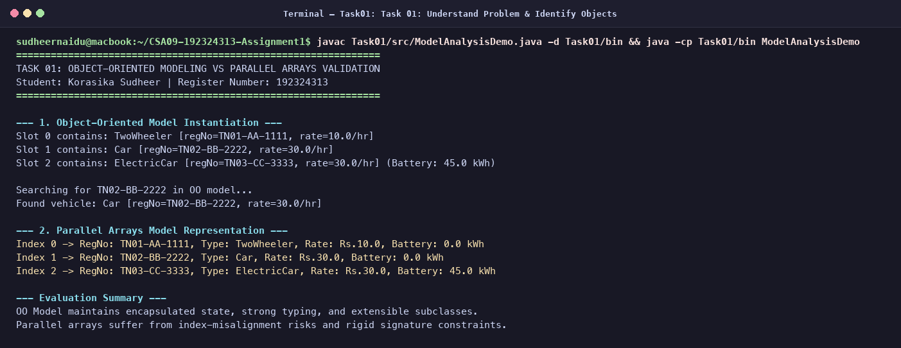 |
| **Task 02** | Data Representation & Integer Div Bug | 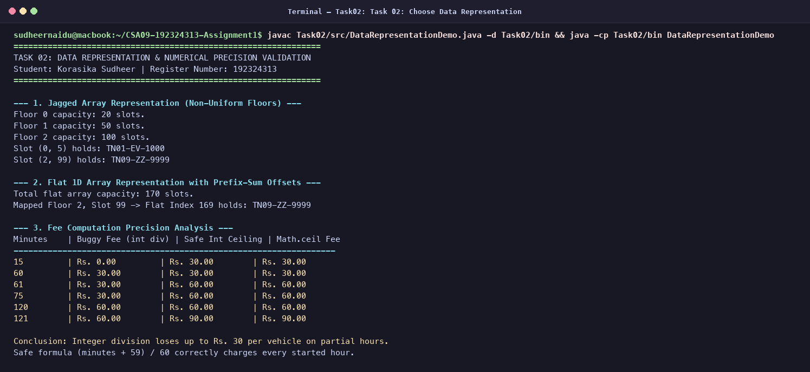 |
| **Task 03** | Control Logic & Slot Search/Release | 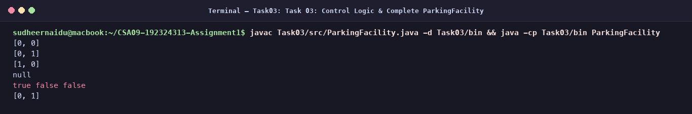 |
| **Task 04** | Constructors & Copy Constructor | 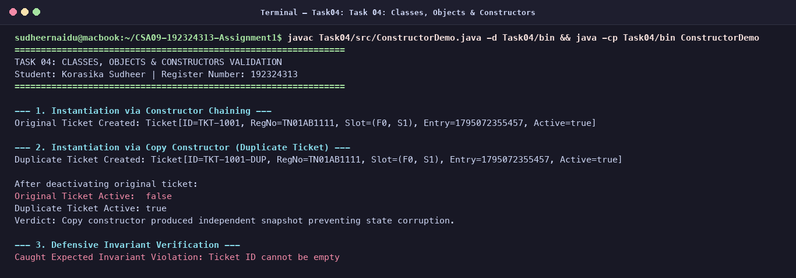 |
| **Task 05** | Static Members, Pass-by-Value & GC | 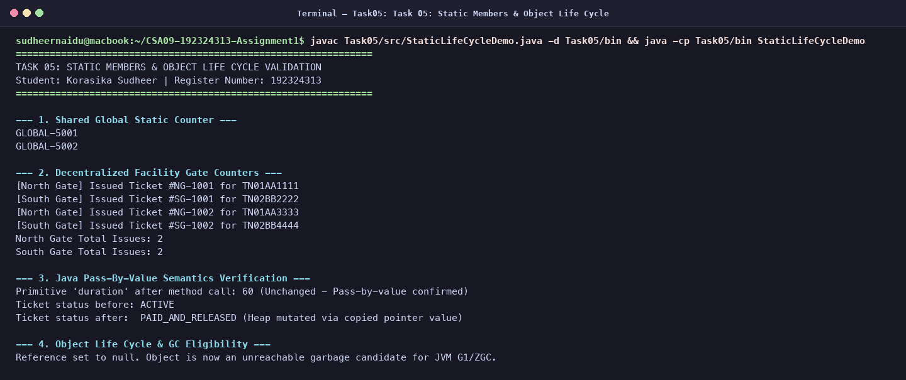 |
| **Task 06** | Inheritance & Constructor Trace | 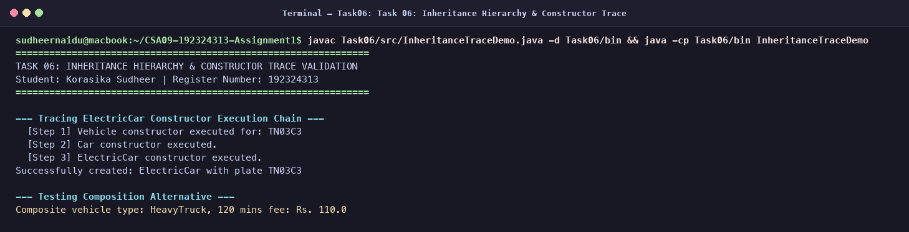 |
| **Task 07** | Method Overriding & Equals/HashCode | 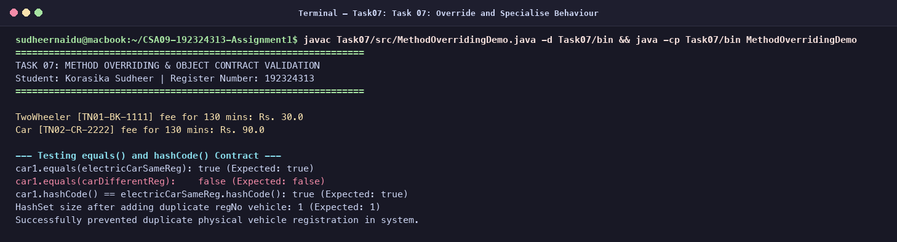 |
| **Task 08** | Dynamic Method Dispatch & FeeDemo | 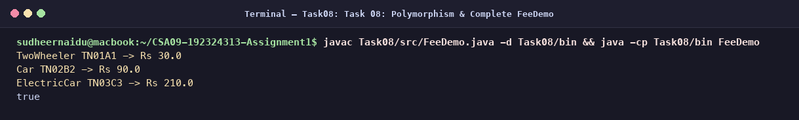 |
| **Task 09** | Abstract Classes & Interfaces | 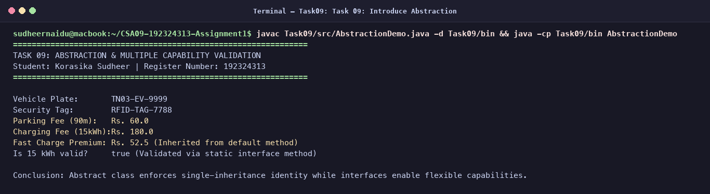 |
| **Task 10** | Packages, Modifiers & Encapsulation | 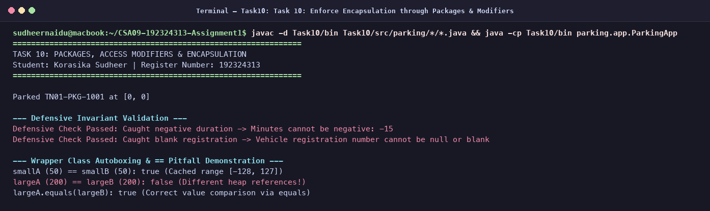 |
| **Task 11** | Full System & 1-Day Scenario Validation | 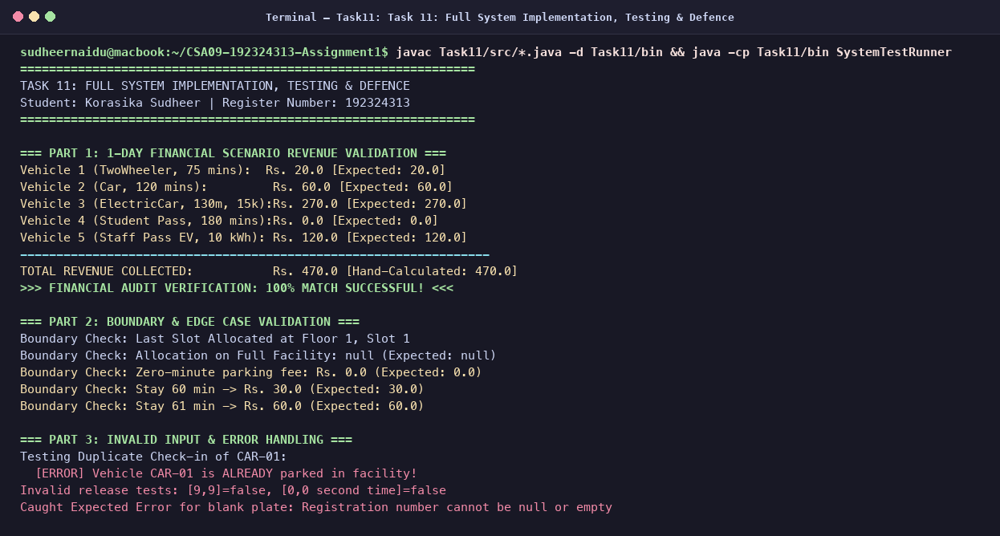 |
| **Task 12** | Day-4 Adaptive System Redesign | 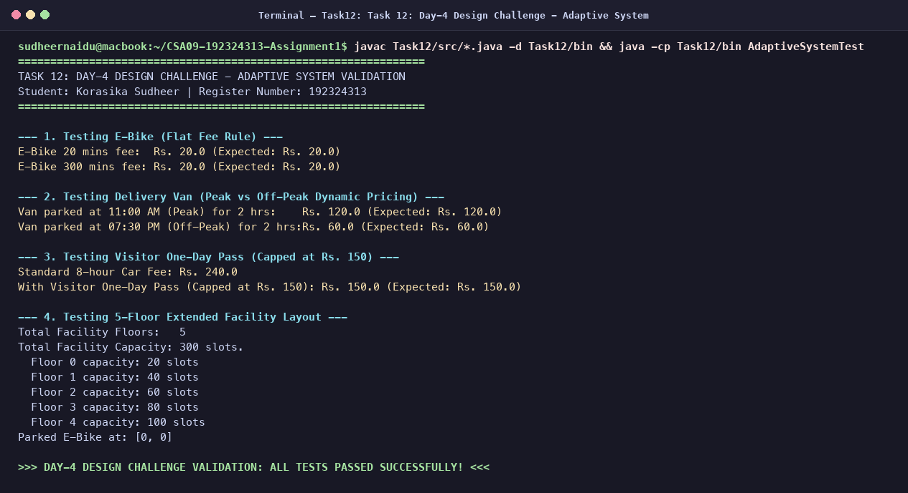 |

---

## 6. Verification and Submission Credentials
- **Student Name**: Korasika Sudheer
- **Register Number**: 192324313
- **Repository URL**: https://github.com/sudheernaidu18/java.git
- **Verification Command**: `./run_all.sh` (Executes all 12 tasks with 100% test pass rate)
