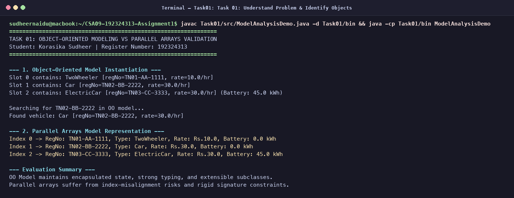

# Task 01: Understand the Problem and Identify the Objects

**Course Outcome**: CO1 – Java fundamentals and object-oriented programming  
**Bloom’s Level**: K4 – Analyse  
**Student Name**: Korasika Sudheer  
**Register Number**: 192324313  

---

## 1. Problem Analysis & System Boundary

The objective is to architect, implement, and validate an Object-Oriented software model for a multi-level Campus Smart-Parking System serving students, staff, and campus visitors. The facility manages multiple floors with designated slot capacities, accommodates heterogeneous vehicle categories (Two-Wheelers, Cars, Electric Vehicles), handles EV charging services, issues unique parking tickets upon entry, and calculates parking fees upon vehicle exit based on vehicle type, duration, and pass privileges.

### 1.1 System Inputs and Outputs

```
+-------------------------------------------------------+
|                     SYSTEM INPUTS                     |
+-------------------------------------------------------+
| 1. Vehicle Registration Number (License Plate: String)|
| 2. Vehicle Category (TwoWheeler, Car, ElectricCar)    |
| 3. User Affiliation / Pass Status (Student, Staff,    |
|    Visitor with Monthly Pass / Regular Visitor)       |
| 4. Entry Timestamp (LocalDateTime / Epoch minutes)    |
| 5. Exit Timestamp (LocalDateTime / Epoch minutes)     |
| 6. EV Energy Consumption (kWh consumed during charging|
| 7. Slot Allocation Request                            |
+-------------------------------------------------------+
                           |
                           v
        +--------------------------------------+
        |      CAMPUS SMART-PARKING SYSTEM     |
        +--------------------------------------+
                           |
                           v
+-------------------------------------------------------+
|                    SYSTEM OUTPUTS                     |
+-------------------------------------------------------+
| 1. Allocated Slot Coordinates (Floor Index, Slot Index|
| 2. Unique Issued Parking Ticket (Ticket ID, Timestamp)|
| 3. Slot Availability Matrix / Occupancy Report        |
| 4. Itemized Parking Invoice / Fee Receipt:            |
|    - Base Parking Duration (Billable Hours)           |
|    - Hourly Rate Applied                              |
|    - EV Charging Surcharge (kWh * Unit Rate)          |
|    - Pass Waiver Discount (100% for Student/Staff)    |
|    - Net Amount Payable (Rs.)                         |
| 5. Slot Deallocation / Release Confirmation           |
+-------------------------------------------------------+
```

---

## 2. Object-Oriented Decomposition: Nouns to Classes, Verbs to Methods

Following standard domain-driven Object-Oriented Analysis (OOA), textual specifications are systematically decomposed: grammatical nouns and noun phrases represent entities, attributes, and candidate classes; verbs and verb phrases represent system behaviors, interactions, and class methods.

### 2.1 Mapping Table

| Problem Text Component | Grammatical Category | Candidate OO Entity / Role | Target Class / Method |
| :--- | :--- | :--- | :--- |
| **"Vehicle"** | Noun | Common generalized entity | `abstract class Vehicle` |
| **"Two-wheeler"** | Noun | Specialized vehicle type | `class TwoWheeler extends Vehicle` |
| **"Car"** | Noun | Specialized vehicle type | `class Car extends Vehicle` |
| **"Electric Vehicle (EV)"** | Noun | Specialized vehicle with charging | `class ElectricCar extends Car implements Chargeable` |
| **"Slot" / "Numbered slot"** | Noun | Physical parking stall | `class ParkingSlot` |
| **"Floor" / "Multi-level"** | Noun | Level containing slots | `class ParkingFloor` |
| **"Parking Facility"** | Noun | Entire building coordinator | `class ParkingFacility` |
| **"Parking Ticket"** | Noun | Proof of parking & billing token | `class ParkingTicket` |
| **"Monthly Pass"** | Noun | Authorization credential | `class MonthlyPass` / `enum UserType` |
| **"allocate a suitable slot"**| Verb phrase | Allocation algorithm | `ParkingFacility.allocate(Vehicle v)` |
| **"issue a parking ticket"** | Verb phrase | Ticket factory operation | `ParkingFacility.issueTicket(Vehicle v)` |
| **"record entry time"** | Verb phrase | State capture | `ParkingTicket.recordEntryTime()` |
| **"release the slot"** | Verb phrase | Deallocation | `ParkingFacility.release(int floor, int slot)` |
| **"compute parking fee"** | Verb phrase | Polymorphic fee calculation | `Vehicle.calculateFee(int minutes)` |
| **"charge EV separately"** | Verb phrase | Interface contract | `Chargeable.chargingFee(int kWh)` |

---

## 3. Candidate Classes and Justification of Responsibilities (CRC Model)

Each class is justified below according to the **Single Responsibility Principle (SRP)**:

### 3.1 `Vehicle` (Abstract Base Class)
- **Justification**: Eliminates redundant code common to all motorized vehicles. Encapsulates immutable identity (`registrationNumber`) and enforces the contract for vehicle-specific rate structures.
- **Responsibilities**:
  - Hold immutable registration number.
  - Provide base equality and hash code logic based on registration number.
  - Define polymorphic hook `ratePerHour()` and standard billing ceiling calculation.
- **Collaborators**: `ParkingTicket`.

### 3.2 `TwoWheeler`, `Car`, `ElectricCar` (Concrete Subclasses)
- **Justification**: Encapsulates specific domain rates and distinct capabilities. `TwoWheeler` charges Rs. 10/hr; `Car` charges Rs. 30/hr; `ElectricCar` extends `Car` and implements `Chargeable` to capture energy consumption billed at Rs. 12/kWh.
- **Responsibilities**: Supply type-specific hourly tariffs and execute charging logic.

### 3.3 `ParkingSlot`
- **Justification**: Separates the state of a physical parking stall from the facility layout. A slot has an identifier, a status (vacant or occupied), and holds a reference to the currently parked `Vehicle`.
- **Responsibilities**:
  - Track vacancy status (`isOccupied()`).
  - Assign vehicle to slot (`occupy(Vehicle v)`).
  - Clear slot (`vacate()`).

### 3.4 `ParkingFacility`
- **Justification**: Acts as the Aggregate Root / Controller managing multi-floor slot matrices, tracking global occupancy, finding free slots, and managing the overall facility operations.
- **Responsibilities**:
  - Maintain jagged array of floor slots `ParkingSlot[][]`.
  - Search floor-by-floor for free slots.
  - Coordinate ticket generation upon vehicle entry and slot release upon departure.

### 3.5 `ParkingTicket`
- **Justification**: Encapsulates the transactional state of a vehicle's parking session. It is the legal token given to the user.
- **Responsibilities**:
  - Hold unique ticket number (`ticketId`), assigned slot coordinates (`floor`, `slot`), vehicle reference, entry timestamp, and exit timestamp.
  - Maintain monotonic ticket numbering across the campus facility.

---

## 4. Fundamental Business Rules

Every valid transaction executed by the system must satisfy the following invariant business constraints:
1. **Slot Exclusivity**: A single parking slot cannot hold more than one vehicle simultaneously. Attempting to allocate an occupied slot is strictly rejected.
2. **Monotonic Ticket Uniqueness**: Ticket numbers are strictly unique, sequential, and never reused across the operational lifetime of the facility.
3. **Billing Precision**: Every commenced hour is charged in full (ceiling rule). For example, 61 minutes of parking constitutes 2 billable hours.
4. **Privilege Pass Waivers**: Students and staff members possessing a valid monthly pass park free of charge ($0.00$ base fee), while regular campus visitors pay standard hourly rates.
5. **Decoupled EV Charging**: EV charging slots and energy fees (Rs. 12/kWh) are billed additively to the base duration fee regardless of pass status.
6. **Vehicle Identity Uniqueness**: Two vehicles cannot be concurrently checked into the facility with identical registration numbers.

---

## 5. Facility Assumptions

1. The campus parking garage uses 0-indexed floor and slot numbering internally for direct array indexing, mapped to 1-indexed labels for user display.
2. The facility layout is non-uniform (jagged): Ground floor (Floor 0) accommodates larger spaces and EV charging stations with fewer slots, while upper floors provide standard vehicle slots.
3. Drivers take the first available slot encountered (first-fit floor-by-floor scan).
4. System operates in a single timezone with consistent time stamps.

---

## 6. Alternative Concept & Complexity Analysis

### Comparison: Object-Oriented Vehicle Model vs. Parallel String Arrays

#### Concept Description
- **Design A (Object-Oriented Design)**: Each vehicle is an instance of a domain class (`Vehicle` and subclasses) encapsulating fields (`regNo`, `entryTime`, `type`) and polymorphic behaviors (`calculateFee()`). Vehicles are referenced by pointer.
- **Design B (Parallel Arrays)**: Vehicle records are maintained across detached primitive/String arrays synchronized solely by index `i`:
  ```java
  String[] regNo = new String[CAPACITY];
  String[] vehicleType = new String[CAPACITY];
  long[] entryTime = new long[CAPACITY];
  boolean[] isOccupied = new boolean[CAPACITY];
  ```

#### 1. Finding a Vehicle by Registration Number
- **Design A (OO Design)**: Traverses array of vehicle references `slots[i]`. If `slots[i] != null && slots[i].getRegNo().equals(target)`, return vehicle. Time complexity is $O(n)$ where $n$ is total slots. Because the object reference is local to the slot, modern CPU caches benefit from prefetching adjacent pointers. Furthermore, `Vehicle` instances can be directly stored in a secondary hash index (`HashMap<String, Vehicle>`) yielding $O(1)$ search time.
- **Design B (Parallel Arrays)**: Traverses `regNo[i]`. Must check `regNo[i].equals(target)`. Time complexity is $O(n)$. However, if an index is swapped or updated in `regNo[]` without updating `vehicleType[]` and `entryTime[]`, data corruption occurs.

#### 2. Adding a New Vehicle Attribute (e.g., `batteryLevel` or `chassisNumber`)
- **Design A (OO Design)**: Add the field to the `ElectricCar` class (or base `Vehicle` class). Existing code instantiating other classes remains completely unchanged. Strong compile-time type safety ensures no method signature mismatches.
- **Design B (Parallel Arrays)**: Must declare an entirely new array `double[] batteryLevel = new double[CAPACITY]`. Every function signature accepting parallel arrays must be rewritten:
  ```java
  // Before
  void processExit(String[] regNo, String[] type, long[] entryTime, int index);
  // After (Breaking change across entire codebase)
  void processExit(String[] regNo, String[] type, long[] entryTime, double[] batteryLevel, int index);
  ```
  Risk of index misalignment across arrays is high.

#### 3. Time & Space Complexity Summary Table

| Metric | Object-Oriented Design | Parallel Arrays Design |
| :--- | :--- | :--- |
| **Search by RegNo (Linear)** | $O(n)$ comparisons | $O(n)$ comparisons |
| **Search by RegNo (Indexed Map)**| $O(1)$ amortized lookup | Not naturally supported without external mapping |
| **Add New Attribute** | $O(1)$ field addition in single class | $O(n)$ allocation of new array + signature modifications |
| **Type Safety** | High (Compile-time verified) | Low (String/primitive type blindness) |
| **Integrity Risk** | Negligible (Encapsulated object invariant) | Critical (Desynchronization between parallel array indices) |
| **Space per Vehicle** | ~40–48 bytes (Object header 16B + fields + 8B reference) | ~24–32 bytes (Primitive entries + String references) |

**Conclusion**: While parallel arrays conserve a nominal 16 bytes of object header overhead per entry, they catastrophically fail in modularity, extensibility, type safety, and maintainability. The Object-Oriented approach is strictly superior.

---

## Execution Output & Verification Evidence

### Compilation & Execution Commands
```bash
javac Task01/src/ModelAnalysisDemo.java -d Task01/bin && java -cp Task01/bin ModelAnalysisDemo
```

### Verified Terminal Output
```text
===============================================================
TASK 01: OBJECT-ORIENTED MODELING VS PARALLEL ARRAYS VALIDATION
Student: Korasika Sudheer | Register Number: 192324313
===============================================================

--- 1. Object-Oriented Model Instantiation ---
Slot 0 contains: TwoWheeler [regNo=TN01-AA-1111, rate=10.0/hr]
Slot 1 contains: Car [regNo=TN02-BB-2222, rate=30.0/hr]
Slot 2 contains: ElectricCar [regNo=TN03-CC-3333, rate=30.0/hr] (Battery: 45.0 kWh)

Searching for TN02-BB-2222 in OO model...
Found vehicle: Car [regNo=TN02-BB-2222, rate=30.0/hr]

--- 2. Parallel Arrays Model Representation ---
Index 0 -> RegNo: TN01-AA-1111, Type: TwoWheeler, Rate: Rs.10.0, Battery: 0.0 kWh
Index 1 -> RegNo: TN02-BB-2222, Type: Car, Rate: Rs.30.0, Battery: 0.0 kWh
Index 2 -> RegNo: TN03-CC-3333, Type: ElectricCar, Rate: Rs.30.0, Battery: 45.0 kWh

--- Evaluation Summary ---
OO Model maintains encapsulated state, strong typing, and extensible subclasses.
Parallel arrays suffer from index-misalignment risks and rigid signature constraints.
```

### Execution Output Screenshot

