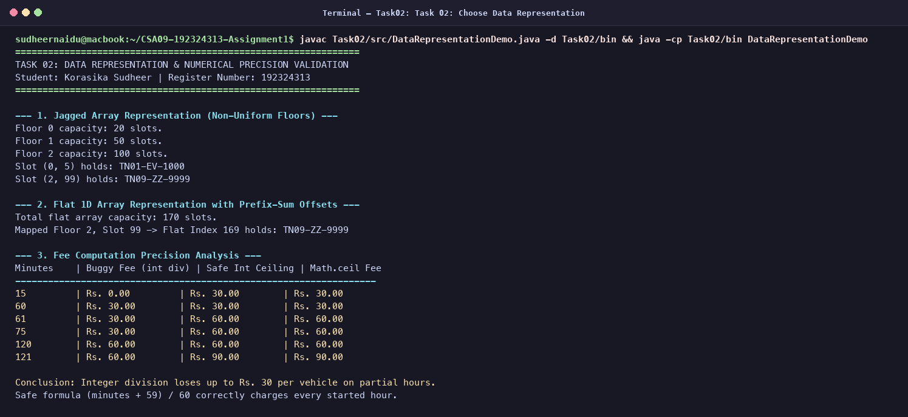

# Task 02: Choose the Data Representation

**Course Outcome**: CO1 – Java fundamentals and object-oriented programming  
**Bloom’s Level**: K4 – Analyse  
**Student Name**: Korasika Sudheer  
**Register Number**: 192324313  

---

## 1. Field-Level Data Type Selection & Architectural Rationale

Choosing appropriate primitive and reference data types in Java requires balancing memory footprint, range boundaries, numerical precision, and semantic correctness.

| Field Name | Selected Java Data Type | Rationale & Trade-off Analysis |
| :--- | :--- | :--- |
| `floorNumber` | `int` | Represents 0-based floor index ($0 \le \text{floor} < 10$). While `byte` uses 1 byte, modern JVM word alignment pads primitives on the operand stack to 32 bits (`int`). Using `int` avoids narrowing casts in array indexing `slots[floor]`. |
| `slotNumber` | `int` | Direct integer array subscript. Non-negative, bounded by floor capacity (e.g., 20, 50, 100). |
| `vehicleNumber`| `String` | Alphanumeric license plate numbers (e.g., `"TN01AB1111"`). Immutable, supports pattern matching (`matches()`), and provides built-in hash code computation for dictionary lookups. |
| `entryTime` | `long` / `LocalDateTime`| `long` represents Unix epoch milliseconds for high-efficiency elapsed time arithmetic (`System.currentTimeMillis()`), avoiding timezone deserialization overhead. `LocalDateTime` is used when human-readable clock hours are required for peak-rate rules. |
| `duration` | `int` / `long` | Expressed in elapsed integer minutes ($t_{\text{exit}} - t_{\text{entry}}$). Eliminates fractional minute rounding errors during time difference computation. |
| `hourlyRate` | `double` | Currency rate per hour (e.g., `10.0`, `30.0`). Provides standard floating-point representation. |
| `parkingFee` | `double` (or `BigDecimal`)| Monetary value. Computed as $\lceil \text{minutes} / 60.0 \rceil \times \text{rate}$. For commercial financial applications, `BigDecimal` prevents binary IEEE-754 floating-point rounding errors; for campus billing where fees are integral multiples of hourly tariffs, `double` or `long` (paise) is computationally optimal. |

---

## 2. Floor and Slot Representation: Comparative Analysis

We evaluate three candidate structures for modeling multi-level parking stalls:

```
1. Rectangular 2D Array: String[FLOORS][FIXED_SLOTS]
   Floor 0: [S0][S1][S2][S3] ... [S99]  (Wasted space if Ground floor has only 20 slots!)
   Floor 1: [S0][S1][S2][S3] ... [S99]

2. Jagged 2D Array: String[FLOORS][] (Selected Architecture)
   Floor 0: [S0][S1] ... [S19]           (Length: 20 slots - EV & Handicap)
   Floor 1: [S0][S1] ... [S49]           (Length: 50 slots)
   Floor 2: [S0][S1] ... [S99]           (Length: 100 slots)

3. Flat 1D Array: String[TOTAL_CAPACITY]
   Offset computed via Prefix-Sum array: offset[floor] + slot
```

### Why the Jagged Array (`String[][]` / `ParkingSlot[][]`) is Chosen:
1. **Physical Reality**: Real-world multi-level campuses do not have uniform floor capacities. Ground floors allocate extensive room for ramps, security kiosks, and EV charging bays (e.g., 20 slots), while middle floors have 50 slots, and open roof decks hold 100 slots.
2. **Memory Economy**: A uniform 2D rectangular array `new String[5][100]` requires $5 \times 100 = 500$ slot references regardless of actual capacity. A jagged array `new String[5][]` allocates exactly the slots required per floor ($20 + 50 + 50 + 100 + 100 = 320$), eliminating 180 unused reference pointers ($36\%$ memory saving).
3. **Array Bounds Protection**: In a jagged array, `slots[f].length` directly returns that specific floor's real capacity, enabling the JVM to throw `ArrayIndexOutOfBoundsException` automatically if an invalid slot is queried.

---

## 3. Type Conversion, Casting Risks & The Integer Division Pitfall

### 3.1 The Integer Division Vulnerability
In Java, dividing two integers truncates the decimal remainder towards zero (floor division):
$$\frac{75}{60} = 1 \quad (\text{discarding remainder } 15)$$

According to the business rule:
> **"Every started hour is charged in full."**

If an engineer naively implements:
```java
// BUGGY IMPLEMENTATION
int hours = minutes / 60; // 75 / 60 yields 1!
double fee = hours * rate; // Charges only 1 hour instead of 2 hours!
```
- A vehicle parked for $75$ minutes at Rs. $30$/hr would be billed:
  $$1 \times 30.0 = \text{Rs. } 30.0 \quad (\text{System loses Rs. } 30.0!)$$
- A vehicle parked for $45$ minutes would be billed:
  $$0 \times 30.0 = \text{Rs. } 0.0 \quad (\text{Parked for 45 minutes completely free!})$$

### 3.2 The Incorrect Double Casting Vulnerability
If an engineer attempts to fix this by casting after integer division:
```java
// STILL BUGGY
int hours = (int) Math.ceil((double) (minutes / 60)); // minutes / 60 evaluates FIRST as integer 1!
```
Because `minutes / 60` executes first due to operator precedence, `(double)(1)` becomes `1.0`, and `Math.ceil(1.0)` is `1.0`. The fee is still calculated incorrectly!

### 3.3 Safe Mathematical Solutions

#### Solution A: Pure Integer Arithmetic Ceiling (Zero Floating Point Overhead)
$$\text{hours} = \frac{\text{minutes} + 59}{60}$$
- For $\text{minutes} = 1$: $\lfloor (1 + 59)/60 \rfloor = 60/60 = 1$ hour.
- For $\text{minutes} = 60$: $\lfloor (60 + 59)/60 \rfloor = 119/60 = 1$ hour.
- For $\text{minutes} = 61$: $\lfloor (61 + 59)/60 \rfloor = 120/60 = 2$ hours.
- For $\text{minutes} = 75$: $\lfloor (75 + 59)/60 \rfloor = 134/60 = 2$ hours.

#### Solution B: Safe Floating Point Division with `Math.ceil()`
```java
int hours = (int) Math.ceil((double) minutes / 60.0);
```

---

## 4. Input Processing Strategy: `Scanner` vs. Command-Line Arguments

- **Interactive CLI (`java.util.Scanner`)**:
  - *Advantage*: Enables interactive menu-driven operation for campus booth operators (e.g., prompt for license plate, scan pass, choose slot).
  - *Risk*: Requires handling `InputMismatchException` and clearing buffer leftover newlines after `nextInt()`.
- **Command-Line Arguments (`String[] args`)**:
  - *Advantage*: Ideal for headless automated testing, CI/CD pipelines, and script-driven batch processing.
  - *Risk*: Requires validating array bounds (`args.length`) before indexing.
- **System Design Decision**: Core business services accept typed domain arguments; CLI input handlers wrap `Scanner` with comprehensive regex validation.

---

## 5. Alternative Concept & Complexity Analysis

### Comparison: Jagged Array vs Flat 1D Array with Mapping vs `ArrayList<String[]>`

#### Scenario: Non-Uniform Floor Capacities
Suppose a 3-floor garage has capacities: Floor 0 = 20 slots, Floor 1 = 50 slots, Floor 2 = 100 slots ($N = 170$ total slots).

```
Representation A: Jagged Array (String[3][])
- slots[0] = new String[20]
- slots[1] = new String[50]
- slots[2] = new String[100]

Representation B: Single Flat 1D Array (String[170])
- Requires Prefix-Sum Offset Table: offsets = {0, 20, 70}
- Direct formula "floor * slotsPerFloor + slot" FAILS because slotsPerFloor is not constant!
- Index = offsets[floor] + slot

Representation C: Dynamic List of Arrays (ArrayList<String[]>)
- List with 3 elements, each holding String[slotsPerFloor]
```

### Detailed Metric Comparison

| Evaluation Metric | Representation A: Jagged Array `String[][]` | Representation B: Flat 1D Array `String[]` | Representation C: `ArrayList<String[]>` |
| :--- | :--- | :--- | :--- |
| **Locate Slot `(f, s)` Time**| $O(1)$ (Pointer dereference `slots[f][s]`) | $O(1)$ (`slots[offsets[f] + s]`) | $O(1)$ (`list.get(f)[s]`) |
| **Array Creation Time** | $O(F)$ allocations | $O(1)$ single buffer allocation | $O(F)$ wrapper allocations |
| **Formula Simplicity** | Direct array syntax `slots[f][s]` | Requires auxiliary offset table | Method call overhead `get(f)[s]` |
| **Cache Locality** | Medium (Outer array contains pointers to row arrays) | **Optimal** (Contiguous memory block for all slots) | Medium-Low (ArrayList object + elementData array + row arrays) |
| **Space Overhead** | $F$ row array headers (~24B each) = $24F$ bytes | **Zero overhead** beyond single array header | `ArrayList` object (24B) + backing array (24B) + $F$ row headers |
| **Resizing a Floor** | Reallocate single floor array $O(S_f)$ | Must reallocate entire facility buffer $O(\sum S_i)$ | Reallocate single floor array $O(S_f)$ |

### Conclusion
When floor capacities vary:
- The standard flat 1D formula `index = floor * slotsPerFloor + slot` **fails mathematically** because `slotsPerFloor` is a variable, not a constant. Supporting non-uniform floors in a 1D array requires an auxiliary prefix-sum array `offsets[]`, adding indirection.
- The **Jagged Array (`String[][]`)** provides the most elegant, idiomatic, and memory-safe representation in Java, offering $O(1)$ direct access while naturally modeling real-world structural garage variance.

---

## Execution Output & Verification Evidence

### Compilation & Execution Commands
```bash
javac Task02/src/DataRepresentationDemo.java -d Task02/bin && java -cp Task02/bin DataRepresentationDemo
```

### Verified Terminal Output
```text
===============================================================
TASK 02: DATA REPRESENTATION & NUMERICAL PRECISION VALIDATION
Student: Korasika Sudheer | Register Number: 192324313
===============================================================

--- 1. Jagged Array Representation (Non-Uniform Floors) ---
Floor 0 capacity: 20 slots.
Floor 1 capacity: 50 slots.
Floor 2 capacity: 100 slots.
Slot (0, 5) holds: TN01-EV-1000
Slot (2, 99) holds: TN09-ZZ-9999

--- 2. Flat 1D Array Representation with Prefix-Sum Offsets ---
Total flat array capacity: 170 slots.
Mapped Floor 2, Slot 99 -> Flat Index 169 holds: TN09-ZZ-9999

--- 3. Fee Computation Precision Analysis ---
Minutes    | Buggy Fee (int div) | Safe Int Ceiling | Math.ceil Fee   
------------------------------------------------------------------
15         | Rs. 0.00         | Rs. 30.00        | Rs. 30.00       
60         | Rs. 30.00        | Rs. 30.00        | Rs. 30.00       
61         | Rs. 30.00        | Rs. 60.00        | Rs. 60.00       
75         | Rs. 30.00        | Rs. 60.00        | Rs. 60.00       
120        | Rs. 60.00        | Rs. 60.00        | Rs. 60.00       
121        | Rs. 60.00        | Rs. 90.00        | Rs. 90.00       

Conclusion: Integer division loses up to Rs. 30 per vehicle on partial hours.
Safe formula (minutes + 59) / 60 correctly charges every started hour.
```

### Execution Output Screenshot

