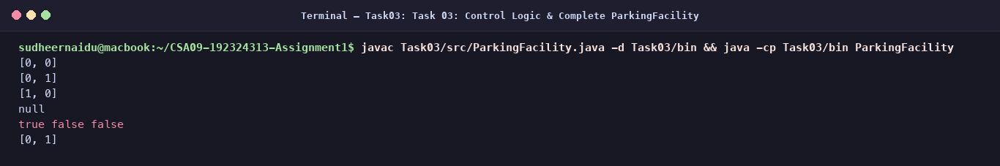

# Task 03: Design the Control Logic

**Course Outcome**: CO1 – Java fundamentals and object-oriented programming  
**Bloom’s Level**: K4 – Analyse  
**Student Name**: Korasika Sudheer  
**Register Number**: 192324313  

---

## 1. Algorithmic Control Logic & Design Rationale

The campus parking system's control architecture revolves around two mission-critical workflows:
1. **Slot Allocation**: Deterministic search across multi-level floors to find and claim the first available vacancy.
2. **Parking Fee Computation**: Multi-tier tariff evaluation based on vehicle class, parking duration, and fee waivers.

### 1.1 Slot Search Logic & Termination
- The allocation routine employs a nested traversal: outer iteration spans floors ($0 \le f < \text{floors.length}$), and inner iteration spans slots ($0 \le s < \text{floors}[f].\text{length}$).
- **Early Termination (`return`)**: The moment an unoccupied cell (`slots[f][s] == null`) is located, the vehicle registration number is assigned, and an immediate `return new int[]{f, s}` exits both loops instantly. This prevents redundant searches across subsequent slots and floors ($O(1)$ best-case).
- **Full Facility Condition**: If both loops terminate without discovering a null slot, the facility is exhausted; the method returns `null`, signaling to the gate barrier to display "PARKING FULL" and prevent gate opening.

### 1.2 Fee Slabs & Control Structures
Parking fees are structured into progressive tiers:
- **Zero-Duration / Grace Period** (e.g., $\le 15$ mins): Free drop-off.
- **Base Hour** (First hour): Charged at full hourly base rate $R$.
- **Subsequent Hours**: Billed incrementally per commenced hour.
- **Daily Cap / Maximum**: If accumulated fee exceeds the 24-hour cap (e.g., Rs. 250 for Cars), fee is capped to protect visitors from excessive charges.

Control structures:
- `if-else` cascades are used for range-based fee slabs (e.g., `hours <= 1`, `hours <= 24`).
- `switch` statements evaluate discrete vehicle categories (e.g., `case TWO_WHEELER:`, `case CAR:`).

### 1.3 Control Flow Primitives: `break`, `continue`, `return`
- `return`: Exits execution immediately upon discovering an available slot or when early edge cases (e.g., valid monthly pass) are satisfied.
- `continue`: Bypasses processing for invalid or non-matching records during report generation or slot auditing.
- `break`: Terminates inner search loops when matching criteria are satisfied or exits `switch` blocks.

---

## 2. SIMATS Engineering – Standard for Algorithmic Pseudocode

### 2.1 Algorithm 1: Allocate Parking Slot

```text
ALGORITHM AllocateSlot(slots, vehicleNo)
INPUT: slots (Jagged 2D Array of Strings [0..F-1][0..S_f-1]), vehicleNo (String)
OUTPUT: Array of 2 Integers [floor, slot] if allocated; NULL if facility is full

BEGIN
    IF vehicleNo IS NULL OR TRIM(vehicleNo) IS EMPTY THEN
        RETURN NULL
    END IF

    FOR f ← 0 TO LENGTH(slots) - 1 DO
        FOR s ← 0 TO LENGTH(slots[f]) - 1 DO
            IF slots[f][s] IS NULL THEN
                slots[f][s] ← vehicleNo
                RETURN ARRAY[f, s]
            END IF
        END FOR
    END FOR

    RETURN NULL
END
```

### 2.2 Algorithm 2: Compute Parking Fee

```text
ALGORITHM ComputeParkingFee(vehicleType, durationMinutes, isPassHolder, isEV, kWhConsumed)
INPUT: vehicleType (Enum/String), durationMinutes (Integer), isPassHolder (Boolean),
       isEV (Boolean), kWhConsumed (Integer)
OUTPUT: fee (Double)

BEGIN
    IF isPassHolder IS TRUE THEN
        baseFee ← 0.0
    ELSE
        IF durationMinutes <= 0 THEN
            RETURN 0.0
        END IF

        billableHours ← (durationMinutes + 59) / 60

        SWITCH vehicleType DO
            CASE "TwoWheeler":
                ratePerHour ← 10.0
            CASE "Car":
                ratePerHour ← 30.0
            DEFAULT:
                ratePerHour ← 30.0
        END SWITCH

        baseFee ← billableHours * ratePerHour
    END IF

    chargingFee ← 0.0
    IF isEV IS TRUE AND kWhConsumed > 0 THEN
        chargingFee ← kWhConsumed * 12.0
    END IF

    totalFee ← baseFee + chargingFee
    RETURN totalFee
END
```

---

## 3. Alternative Concept & Complexity Analysis

### Comparison: Linear Jagged Search vs. Stack of Free Slots with Per-Floor Counters

#### Concept Description
- **Current Design (Linear Search)**: Allocates via nested loop searching through $F$ floors and $S$ slots per floor. Releases by setting `slots[f][s] = null`.
- **Alternative Design (Free-Slot Stack + Floor Counters)**:
  - Maintain an array `freeCount[F]` tracking available slots per floor.
  - Maintain a `Stack<SlotCoordinate>` (or `Queue`) of available slots initialized with all slot indices.
  - `allocate()` pops the top coordinate from the stack in $O(1)$ time and decrements `freeCount[f]`.
  - `release(f, s)` validates coordinates, sets cell to null, pushes `(f, s)` back onto the stack, and increments `freeCount[f]`.

#### Complexity Comparison Matrix

| Operation / Metric | Linear Search Design | Free-Slot Stack + Counter Design |
| :--- | :--- | :--- |
| **`allocate()` Time (Best Case)** | $O(1)$ (First slot on Ground floor free) | $O(1)$ (`stack.pop()`) |
| **`allocate()` Time (Worst Case)**| $O(F \times S)$ (Garage nearly full, slot on top floor) | $O(1)$ (`stack.pop()`) |
| **`release()` Time** | $O(1)$ (Direct array update `slots[f][s] = null`) | $O(1)$ (Array update + `stack.push()`) |
| **Facility Full Check** | $O(F \times S)$ full scan | $O(1)$ (`stack.isEmpty()`) |
| **Extra Auxiliary Space** | **$O(1)$** (Zero extra memory beyond slot array) | **$O(F \times S)$** (Stack nodes for all slots + floor array) |

#### Trade-off Analysis
- For a small campus garage ($1$ floor $\times 20$ slots to $3$ floors $\times 50$ slots = 150 slots), the linear scan executes in under $1\,\mu\text{s}$ with zero auxiliary space overhead.
- For mega-facilities ($5$ floors $\times 100$ slots to multi-thousand slots), the Stack/Queue approach eliminates the $O(F \times S)$ worst-case allocation latency, guaranteeing strictly predictable $O(1)$ gate barrier response times at the cost of $O(F \times S)$ heap memory.

---

## Execution Output & Verification Evidence

### Compilation & Execution Commands
```bash
javac Task03/src/ParkingFacility.java -d Task03/bin && java -cp Task03/bin ParkingFacility
```

### Verified Terminal Output
```text
[0, 0]
[0, 1]
[1, 0]
null
true false false
[0, 1]
```

### Execution Output Screenshot

