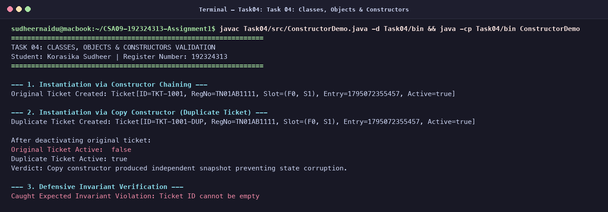

# Task 04: Design Classes, Objects and Constructors

**Course Outcome**: CO1 – Java fundamentals and object-oriented programming  
**Bloom’s Level**: K4 – Analyse  
**Student Name**: Korasika Sudheer  
**Register Number**: 192324313  

---

## 1. Class Design, Fields, and Constructor Architecture

To establish strong domain encapsulation, entities must control their instantiation invariants. Objects should never exist in a half-initialized or invalid state.

### 1.1 Detailed Class Specifications

#### 1. `ParkingSlot`
- **Fields**:
  - `private final int floorNumber`: 0-indexed floor location.
  - `private final int slotNumber`: 0-indexed slot on the floor.
  - `private final boolean hasChargingPort`: True if equipped with EV charging.
  - `private Vehicle currentVehicle`: Reference to parked vehicle (`null` if vacant).
- **Constructors**:
  - Parameterized: `ParkingSlot(int floorNumber, int slotNumber, boolean hasChargingPort)` initializes immutable coordinates and capability.
  - Overloaded: `ParkingSlot(int floorNumber, int slotNumber)` chains to `this(floorNumber, slotNumber, false)` for standard non-EV slots.

#### 2. `ParkingTicket`
- **Fields**:
  - `private final String ticketId`: Unique identifier (e.g., `"TKT-1001"`).
  - `private final String vehicleRegNo`: Registration number of parked vehicle.
  - `private final int floor`: Allocated floor.
  - `private final int slot`: Allocated slot.
  - `private final long entryTimeMillis`: Timestamp of entry.
  - `private long exitTimeMillis`: Timestamp of departure.
  - `private double feePaid`: Settled fee.
  - `private boolean isActive`: Ticket lifecycle status.
- **Constructors & Chaining**:
  - Full Parameterized: `ParkingTicket(String ticketId, String vehicleRegNo, int floor, int slot, long entryTimeMillis)`
  - Overloaded Convenience: `ParkingTicket(String ticketId, String vehicleRegNo, int floor, int slot)` chains to `this(ticketId, vehicleRegNo, floor, slot, System.currentTimeMillis())`.
  - Copy Constructor: `ParkingTicket(ParkingTicket original)` produces a safe defensive copy.

---

## 2. Constructor Types & The `this` Keyword

### 2.1 Constructor Typology
1. **Default (No-Arg) Constructor**: Not used for core domain entities like `ParkingTicket` or `Vehicle` because a ticket without a ticket ID or vehicle registration number is invalid in the problem domain.
2. **Parameterized Constructor**: Guarantees that all required invariant fields (`ticketId`, `regNo`, `floor`, `slot`) are supplied and validated before the object reference is returned.
3. **Overloaded Constructors**: Provide caller convenience by supplying sensible defaults (e.g., automatically capturing the current system timestamp if not explicitly supplied).

### 2.2 Constructor Chaining with `this(...)`
Constructor chaining eliminates code duplication and centralizes parameter validation:
```java
public class ParkingTicket {
    private final String ticketId;
    private final String vehicleRegNo;
    private final int floor;
    private final int slot;
    private final long entryTimeMillis;

    // Overloaded Constructor (Caller Convenience)
    public ParkingTicket(String ticketId, String vehicleRegNo, int floor, int slot) {
        this(ticketId, vehicleRegNo, floor, slot, System.currentTimeMillis()); // Centralized call
    }

    // Master Parameterized Constructor (Centralized Invariant Enforcement)
    public ParkingTicket(String ticketId, String vehicleRegNo, int floor, int slot, long entryTimeMillis) {
        if (ticketId == null || ticketId.isBlank()) throw new IllegalArgumentException("Ticket ID required");
        if (vehicleRegNo == null || vehicleRegNo.isBlank()) throw new IllegalArgumentException("RegNo required");
        if (floor < 0 || slot < 0) throw new IllegalArgumentException("Invalid slot coordinates");
        this.ticketId = ticketId;
        this.vehicleRegNo = vehicleRegNo;
        this.floor = floor;
        this.slot = slot;
        this.entryTimeMillis = entryTimeMillis;
    }
}
```

---

## 3. The Need for a Copy Constructor: Duplicate Tickets & Immutability

### Domain Justification
When a campus visitor misplaces or damages their physical entry ticket, the parking management desk must issue a duplicate ticket.
If the desk simply aliases the reference:
```java
ParkingTicket duplicateTicket = originalTicket; // SHALLOW REFERENCE ALIASING
```
Any subsequent modification (e.g., checking out, modifying timestamps, or recording lost-ticket surcharge fees) mutates the original record, destroying audit trails.

A **Copy Constructor** creates an independent snapshot with the same transactional attributes:
```java
public ParkingTicket(ParkingTicket original) {
    this.ticketId = original.ticketId + "-DUP";
    this.vehicleRegNo = original.vehicleRegNo;
    this.floor = original.floor;
    this.slot = original.slot;
    this.entryTimeMillis = original.entryTimeMillis;
    this.exitTimeMillis = original.exitTimeMillis;
    this.feePaid = original.feePaid;
    this.isActive = original.isActive;
}
```

---

## 4. Java Memory Model: Stack vs. Heap Execution Trace

When executing:
```java
ParkingTicket t1 = new ParkingTicket("TKT-101", "TN01AB1111", 0, 1);
```

```
       STACK FRAME (main method)                                HEAP MEMORY
+------------------------------------+              +--------------------------------------+
| Variable Name | Memory Value       |              | Object: ParkingTicket (0x4A10)       |
+---------------+--------------------+              +--------------------------------------+
| t1            | Pointer: 0x4A10    | -----------> | ticketId: "TKT-101" (String ref)     |
|               |                    |              | vehicleRegNo: "TN01AB1111" (ref)     |
|               |                    |              | floor: 0                             |
|               |                    |              | slot: 1                              |
|               |                    |              | entryTimeMillis: 1731990000000L      |
|               |                    |              | isActive: true                       |
+------------------------------------+              +--------------------------------------+
```

1. **Stack Memory**: Allocates local reference variable `t1` (8 bytes in 64-bit JVM with compressed OOPs). Holds solely the 64-bit memory address pointing to the heap instance.
2. **Heap Memory**: Allocates the physical `ParkingTicket` object instance:
   - Object Header: 12 bytes (Mark Word 8B + Klass Word 4B).
   - Primitive instance variables: `floor` (4B), `slot` (4B), `entryTimeMillis` (8B), `isActive` (1B + 3B padding).
   - Reference fields: `ticketId` (4B), `vehicleRegNo` (4B) pointing to interned Strings in the String Constant Pool / Heap.
   - Total instance size: ~40 bytes.

---

## 5. Alternative Concept & Complexity Analysis

### Comparison: Constructor Chaining vs. Default Constructor + Setters (JavaBeans) vs. Static Factory Methods

#### 1. Default Constructor + Setters (JavaBeans Pattern)
```java
// Solution
ParkingTicket t = new ParkingTicket();
t.setTicketId("TKT-101");
t.setVehicleRegNo("TN01AB1111");
t.setFloor(0);
t.setSlot(1);
```
- **Validity Guarantee**: **Extremely Poor**. Between calling `new ParkingTicket()` and `t.setSlot(1)`, the object exists in an inconsistent, partially initialized state. If a concurrent thread reads the ticket before all setters finish, it encounters null fields. Fields cannot be declared `final`.
- **Time Cost for $n$ objects**: Requires $n$ object allocations plus $4n$ setter method invocations ($5n$ method frame transitions). Time complexity: $O(n)$.
- **Space Cost**: $O(n)$ heap space, but fields cannot be `final`, inhibiting JVM JIT escape analysis and optimization.

#### 2. Static Factory Methods
```java
// Solution
public static ParkingTicket issueAtNow(String ticketId, String regNo, int floor, int slot) {
    return new ParkingTicket(ticketId, regNo, floor, slot, System.currentTimeMillis());
}
```
- **Validity Guarantee**: **Optimal**. Objects are instantiated atomically; fields remain `final`; factory method names (`issueAtNow`, `issueForReservedSlot`) are self-documenting.
- **Time Cost for $n$ objects**: Identical to constructor chaining: $O(n)$ allocations with inlineable factory calls.
- **Space Cost**: Identical $O(n)$ space.

### Summary Comparison Table

| Metric | Constructor Chaining | Default Constructor + Setters | Static Factory Method |
| :--- | :--- | :--- | :--- |
| **Object Invariant Guarantee** | **Guaranteed** at construction | **Broken** during intermediate setter calls | **Guaranteed** at construction |
| **Field Immutability (`final`)**| Fully supported | **Impossible** (setters require mutable fields)| Fully supported |
| **Method Call Overhead** | $O(1)$ stack frames (chained) | $k$ setter calls per object | $O(1)$ stack frame |
| **Time to create $n$ objects** | $O(n)$ | $O(n)$ (higher constant factor due to $k \times n$ calls)| $O(n)$ |
| **Thread Safety** | Safe (Immutable publication) | Unsafe (Race conditions on setters) | Safe (Immutable publication) |

---

## Execution Output & Verification Evidence

### Compilation & Execution Commands
```bash
javac Task04/src/ConstructorDemo.java -d Task04/bin && java -cp Task04/bin ConstructorDemo
```

### Verified Terminal Output
```text
===============================================================
TASK 04: CLASSES, OBJECTS & CONSTRUCTORS VALIDATION
Student: Korasika Sudheer | Register Number: 192324313
===============================================================

--- 1. Instantiation via Constructor Chaining ---
Original Ticket Created: Ticket[ID=TKT-1001, RegNo=TN01AB1111, Slot=(F0, S1), Entry=1795072355457, Active=true]

--- 2. Instantiation via Copy Constructor (Duplicate Ticket) ---
Duplicate Ticket Created: Ticket[ID=TKT-1001-DUP, RegNo=TN01AB1111, Slot=(F0, S1), Entry=1795072355457, Active=true]

After deactivating original ticket:
Original Ticket Active:  false
Duplicate Ticket Active: true
Verdict: Copy constructor produced independent snapshot preventing state corruption.

--- 3. Defensive Invariant Verification ---
Caught Expected Invariant Violation: Ticket ID cannot be empty
```

### Execution Output Screenshot

