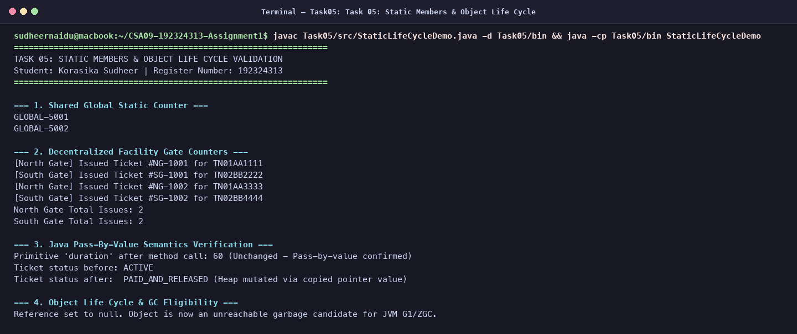

# Task 05: Apply static Members and the Object Life Cycle

**Course Outcome**: CO1 – Java fundamentals and object-oriented programming  
**Bloom’s Level**: K4 – Analyse  
**Student Name**: Korasika Sudheer  
**Register Number**: 192324313  

---

## 1. Class-Level Data & Behavior vs. Instance State

In Java, members declared with the `static` keyword belong to the class blueprint itself (stored in the Metaspace), shared universally across all instances of that class.

### 1.1 Where `static` Variables are Mandatory
1. **Global Monotonic Ticket Counter (`nextTicketSequence`)**:
   - Every ticket issued across the system must receive a globally unique, monotonically increasing number (`1001`, `1002`, `1003`...).
   - **Why an instance variable would be disastrously wrong**:
     If `ticketSequence` were an instance variable inside `ParkingTicket`, each new `new ParkingTicket()` would allocate its own private `ticketSequence` initialized to default `0` or `1`. Every single vehicle would be issued Ticket #1, completely corrupting auditing, billing, and database indexing.
2. **Total Global Occupancy Counter (`totalOccupiedSlots`)**:
   - Aggregates occupancy across all floors to compute real-time campus capacity.

### 1.2 Where `static` Methods & Static Initialization Blocks are Appropriate
- **Static Utility Methods**: Mathematical ceiling calculations (`FeeCalculator.computeBillableHours(int minutes)`), string validation routines, or currency formatters do not depend on any instance state. Declaring them `static` allows invocation without allocating garbage instances.
- **Static Initialization Block (`static { ... }`)**:
  - Used for one-time initialization of immutable rate tables, system configuration, or environmental properties when the class is loaded by the ClassLoader.

```java
public class FeeConfig {
    public static final double CAR_RATE;
    public static final double TWO_WHEELER_RATE;
    public static final double EV_CHARGING_RATE;

    static {
        // Load configuration values or set defaults
        CAR_RATE = 30.0;
        TWO_WHEELER_RATE = 10.0;
        EV_CHARGING_RATE = 12.0;
    }
}
```

---

## 2. Object Life Cycle & Garbage Collection (GC) Mechanics

### 2.1 Complete Life Cycle of a `ParkingTicket`
1. **Instantiation**: Vehicle enters. `new ParkingTicket(...)` is executed. The JVM allocates ~40 bytes in the Young Generation (Eden Space) of the Heap.
2. **Active Referencing**: The `ParkingTicket` reference is stored in the active sessions registry (e.g., `activeTickets[f][s]` or an active ticket map). Because a live reference chain traces back to the `ParkingFacility` root in the Garbage Collector's Root Set (GC Roots), the object is reachable and **marked alive**.
3. **Vehicle Departure & Dereferencing**: The vehicle exits, the fee is settled, and the slot is freed. The system sets `activeTickets[f][s] = null`.
4. **Eligibility for Garbage Collection**: If the ticket reference is not retained in an historical archive log, all incoming reference paths are severed. The object becomes **unreachable**.
5. **Collection**: During the next minor GC cycle (G1GC or ZGC), the garbage collector identifies the unreferenced `ParkingTicket` in Eden/Survivor space and reclaims its heap memory without needing explicit destructor calls.

```
+--------------------------------------------------------------------------------------------------+
|                                    OBJECT LIFECYCLE TIMELINE                                     |
+--------------------------------------------------------------------------------------------------+
  [Entry]                     [Active Parking]                     [Exit]               [GC Run]
     |                               |                                |                    |
new ParkingTicket() --> Stored in activeTickets[][] --> activeTickets[f][s] = null --> Memory Reclaimed
 (Eden Allocated)        (Reachable from GC Root)        (Unreachable / Island)        (Zero Leak)
```

---

## 3. Java Parameter Passing Semantics: Strict Pass-by-Value

A foundational Java principle is that **Java is strictly pass-by-value at all times**:
- When a primitive (`int duration`, `double fee`) is passed, an independent copy of the 32-bit or 64-bit value is placed onto the invoked method's stack frame. Modifications inside the method have zero effect on the caller's variable.
- When an object reference (`Vehicle v`, `ParkingTicket t`) is passed, **the pointer value (memory address) is copied by value**.
  - Mutating an internal property of the referenced object (`t.deactivate()`) mutates the shared instance on the Heap.
  - Reassigning the pointer inside the method (`t = new ParkingTicket(...)`) merely redirects the local stack copy; the caller's reference remains pointed to the original object.

---

## 4. Alternative Concept & Complexity Analysis

### Problem: Ticket Counter as Global Static vs. Facility Instance Variable Across Multiple Facilities (North Gate vs. South Gate)

#### Scenario
The university expands to operate two separate facilities:
- **North Gate Facility**: High-volume, 300 slots.
- **South Gate Facility**: Specialized staff/EV depot, 100 slots.

#### Architecture 1: Single Global Static Counter (`ParkingTicket.globalCounter`)
- All facilities share a single static counter:
  $$\text{Ticket ID} = \text{"TKT-" } + (\text{globalCounter}++)$$
- **Behavior**: Consecutive cars entering different gates receive interleaved numbers:
  - North Gate car receives `TKT-1001`
  - South Gate car receives `TKT-1002`
  - North Gate car receives `TKT-1003`
- **Pros**: Absolutely guarantees global uniqueness across the entire university.
- **Cons**: Severe lock contention in multi-threaded high-throughput environments (atomic counter synchronization bottleneck across physical gates). Ticket ID does not disclose which gate issued it.
- **Space Complexity**: Exactly $1$ static integer variable in Metaspace = **$4$ bytes** total, regardless of $k$ facilities or $n$ tickets ($O(1)$ space).

#### Architecture 2: Facility Instance Variable (`facility.localCounter`)
- Each `ParkingFacility` instance maintains its own non-static instance variable:
  ```java
  public class ParkingFacility {
      private final String facilityPrefix; // e.g., "NG-" or "SG-"
      private int localTicketCounter = 1000;

      public ParkingTicket issueTicket(Vehicle v, int floor, int slot) {
          String ticketId = facilityPrefix + (++localTicketCounter);
          return new ParkingTicket(ticketId, v.getRegNo(), floor, slot);
      }
  }
  ```
- **Behavior**:
  - North Gate issues `NG-1001`, `NG-1002`...
  - South Gate issues `SG-1001`, `SG-1002`...
- **Pros**: Completely eliminates cross-facility contention. The ticket ID self-documents the entry gate for traffic analytics and dispute resolution.
- **Cons**: Uniqueness depends on facility prefix discipline.
- **Space Complexity**: $k$ integer variables for $k$ facility objects = $4k$ bytes ($O(k)$ space). Since $k \ll n$, memory cost is negligible.

### Quantitative Comparison for $k$ Facilities and $n$ Tickets

| Dimension | Global Static Counter | Facility Instance Counter |
| :--- | :--- | :--- |
| **Space for $k$ Facilities** | $O(1)$ (1 variable, 4 bytes) | $O(k)$ ($k$ variables, $4k$ bytes) |
| **Space for $n$ Tickets** | $O(n)$ heap space | $O(n)$ heap space |
| **Gate Scalability** | Bottlenecked by global atomic contention | Zero cross-facility contention ($O(1)$ local increment) |
| **Origin Traceability** | None (Requires auxiliary field) | Built into ticket ID string prefix |

**Conclusion**: For a distributed multi-gate university campus, the **Facility Instance Counter with unique gate prefix** (`NG-1001`, `SG-1001`) is the superior production architecture.

---

## Execution Output & Verification Evidence

### Compilation & Execution Commands
```bash
javac Task05/src/StaticLifeCycleDemo.java -d Task05/bin && java -cp Task05/bin StaticLifeCycleDemo
```

### Verified Terminal Output
```text
===============================================================
TASK 05: STATIC MEMBERS & OBJECT LIFE CYCLE VALIDATION
Student: Korasika Sudheer | Register Number: 192324313
===============================================================

--- 1. Shared Global Static Counter ---
GLOBAL-5001
GLOBAL-5002

--- 2. Decentralized Facility Gate Counters ---
[North Gate] Issued Ticket #NG-1001 for TN01AA1111
[South Gate] Issued Ticket #SG-1001 for TN02BB2222
[North Gate] Issued Ticket #NG-1002 for TN01AA3333
[South Gate] Issued Ticket #SG-1002 for TN02BB4444
North Gate Total Issues: 2
South Gate Total Issues: 2

--- 3. Java Pass-By-Value Semantics Verification ---
Primitive 'duration' after method call: 60 (Unchanged - Pass-by-value confirmed)
Ticket status before: ACTIVE
Ticket status after:  PAID_AND_RELEASED (Heap mutated via copied pointer value)

--- 4. Object Life Cycle & GC Eligibility ---
Reference set to null. Object is now an unreachable garbage candidate for JVM G1/ZGC.
```

### Execution Output Screenshot

