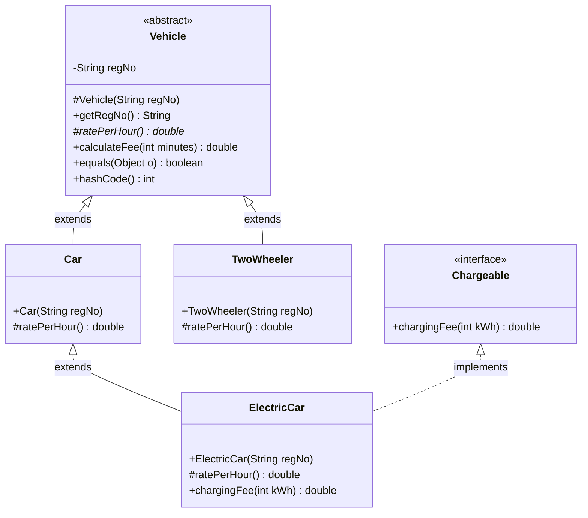
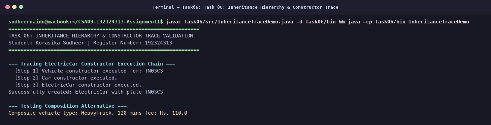

# Task 06: Design the Inheritance Hierarchy

**Course Outcome**: CO1 – Java fundamentals and object-oriented programming  
**Bloom’s Level**: K4 – Analyse  
**Student Name**: Korasika Sudheer  
**Register Number**: 192324313  

---

## 1. Inheritance Architecture: Structure & Taxonomy

The Campus Smart-Parking System implements both **hierarchical inheritance** and **multilevel inheritance**:

1. **Hierarchical Inheritance**:
   - `Vehicle` serves as the abstract root base class.
   - Both `TwoWheeler` and `Car` directly extend `Vehicle`.
2. **Multilevel Inheritance**:
   - `ElectricCar` extends `Car`, which in turn extends `Vehicle`, which in turn extends `java.lang.Object`.
   $$\text{java.lang.Object} \longrightarrow \text{Vehicle} \longrightarrow \text{Car} \longrightarrow \text{ElectricCar}$$
3. **User / Privilege Hierarchy**:
   - `User` abstract class extended by `StudentUser`, `StaffUser`, and `VisitorUser`.

```
                        +----------------------------+
                        |      java.lang.Object      |
                        +----------------------------+
                                      ^
                                      |
                      +--------------------------------+
                      |     abstract class Vehicle     |
                      +--------------------------------+
                      | - regNo: String                |
                      +--------------------------------+
                      | + getRegNo(): String           |
                      | # ratePerHour(): double [abs]  |
                      | + calculateFee(min): double    |
                      +--------------------------------+
                               ^              ^
                               |              |
          +--------------------+              +--------------------+
          |                                                        |
+----------------------+                                 +--------------------+
| class TwoWheeler     |                                 |     class Car      |
+----------------------+                                 +--------------------+
| # ratePerHour(): 10  |                                 | # ratePerHour(): 30|
+----------------------+                                 +--------------------+
                                                                   ^
                                                                   |
                                                      +----------------------------+
                                                      |     class ElectricCar      |
                                                      +----------------------------+
                                                      | Implements Chargeable      |
                                                      | + chargingFee(kWh): double |
                                                      +----------------------------+
```

---

## 2. Inheritance Mapping: Fields, Methods & The Role of `super`

| Class | Inherited from Superclass | Newly Added in Subclass |
| :--- | :--- | :--- |
| `Vehicle` (Super) | `Object` methods (`toString`, `equals`, `hashCode`) | `regNo` field, `getRegNo()`, abstract `ratePerHour()`, template `calculateFee(int minutes)` |
| `TwoWheeler` | `regNo`, `getRegNo()`, `calculateFee(int minutes)` | Overridden `ratePerHour()` returning Rs. 10.0 |
| `Car` | `regNo`, `getRegNo()`, `calculateFee(int minutes)` | Overridden `ratePerHour()` returning Rs. 30.0 |
| `ElectricCar` | `Car` & `Vehicle` state and rate behaviors | Implements `Chargeable` interface; adds `chargingFee(int kWh)` at Rs. 12.0/kWh |

### Usage of the `super` Keyword
1. **In Constructors (`super(...)`)**:
   - Java requires that a subclass constructor invoke a superclass constructor as its very first statement (`super(regNo)`).
   - This ensures the superclass's private fields (`regNo`) are properly initialized and validated before subclass logic executes.
2. **In Overridden Methods (`super.method()`)**:
   - Allows a subclass to augment rather than completely replace superclass functionality.

---

## 3. Constructor Execution Order & Execution Trace

When a client instantiates an `ElectricCar`:
```java
ElectricCar ec = new ElectricCar("TN03C3");
```

### Trace of Constructor Invocations (Top-Down Execution):
1. JVM allocates zeroed memory for `ElectricCar` on Heap.
2. `ElectricCar(String regNo)` is invoked. Its first statement `super(regNo)` delegates to `Car(String regNo)`.
3. `Car(String regNo)` is entered. Its first statement `super(regNo)` delegates to `Vehicle(String regNo)`.
4. `Vehicle(String regNo)` is entered. Its implicit first statement `super()` delegates to `java.lang.Object()`.
5. **Execution Order of Constructor Bodies**:
   - **Step 1**: `java.lang.Object` constructor completes initialization.
   - **Step 2**: `Vehicle` constructor assigns `this.regNo = "TN03C3"`.
   - **Step 3**: `Car` constructor executes (completing any car-specific setup).
   - **Step 4**: `ElectricCar` constructor executes (completing EV charging setup).
   - **Step 5**: The fully constructed reference is returned to variable `ec`.

---

## 4. UML Class Diagram



---

## 5. Alternative Concept & Complexity Analysis

### Comparison: Inheritance (`is-a`) vs. Composition (`has-a`)

#### Concept Description
- **Design A (Inheritance)**: `Car is-a Vehicle`, `TwoWheeler is-a Vehicle`. Different rates are defined via subclass polymorphism (`ratePerHour()`).
- **Design B (Composition / Strategy)**: A single concrete `Vehicle` class contains a reference to a `VehicleType` descriptor:
  ```java
  public class VehicleType {
      private final String typeName;
      private final double ratePerHour;
      // Constructor & getters
  }

  public class Vehicle {
      private final String regNo;
      private final VehicleType vehicleType; // Composition: has-a VehicleType
      public double calculateFee(int minutes) {
          return ((minutes + 59) / 60) * vehicleType.getRatePerHour();
      }
  }
  ```

#### 1. Adding a New Vehicle Type (e.g., Heavy Commercial Truck or Ambulance)
- **Inheritance**: Must author, compile, and deploy a new Java class `public class HeavyTruck extends Vehicle`. While clean and type-safe, new types cannot be added dynamically at runtime from a database or JSON configuration file.
- **Composition**: Zero new classes needed! A parking operator simply instantiates `new VehicleType("HeavyTruck", 50.0)` dynamically at runtime.

#### 2. Time and Space Complexity Comparison

| Dimension | Inheritance Design (`Car is-a Vehicle`) | Composition Design (`Vehicle has-a VehicleType`) |
| :--- | :--- | :--- |
| **Work to Add New Type** | High (Code new class, recompile) | **Zero code change** (Dynamic data instantiation) |
| **Fee Calculation Time** | $O(1)$ (vtable lookup dispatch) | $O(1)$ (Direct field pointer indirection) |
| **Space per Vehicle Object** | **Smaller**: Header (12B) + `regNo` pointer (4B) = **16 bytes** payload | **Larger**: Header (12B) + `regNo` pointer (4B) + `typeRef` pointer (4B) = **20 bytes** payload |
| **Specialized Behaviors** | Excellent: Subclasses naturally hold distinct state (e.g. EV battery kWh) | Poor: A single `Vehicle` class struggles to model capabilities like charging ports without optional/null fields |

**Conclusion**: For systems where vehicles possess fundamentally different physical capabilities (e.g., EV charging, trailer hitching), **Inheritance** provides superior type safety and behavioral modeling. For pure pricing tables without behavioral variation, **Composition** is superior.

---

## Execution Output & Verification Evidence

### Compilation & Execution Commands
```bash
javac Task06/src/InheritanceTraceDemo.java -d Task06/bin && java -cp Task06/bin InheritanceTraceDemo
```

### Verified Terminal Output
```text
===============================================================
TASK 06: INHERITANCE HIERARCHY & CONSTRUCTOR TRACE VALIDATION
Student: Korasika Sudheer | Register Number: 192324313
===============================================================

--- Tracing ElectricCar Constructor Execution Chain ---
  [Step 1] Vehicle constructor executed for: TN03C3
  [Step 2] Car constructor executed.
  [Step 3] ElectricCar constructor executed.
Successfully created: ElectricCar with plate TN03C3

--- Testing Composition Alternative ---
Composite vehicle type: HeavyTruck, 120 mins fee: Rs. 110.0
```

### Execution Output Screenshot

