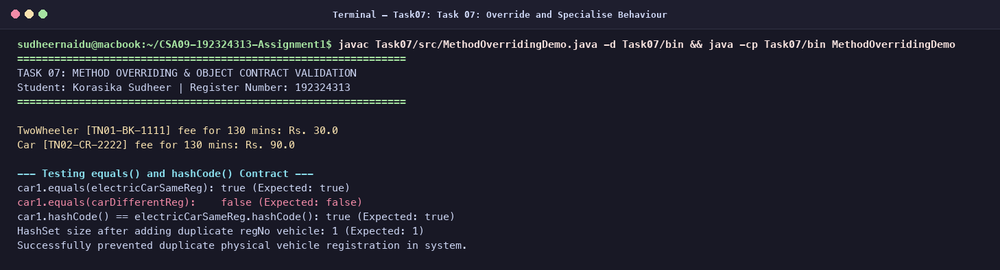

# Task 07: Override and Specialise Behaviour

**Course Outcome**: CO1 – Java fundamentals and object-oriented programming  
**Bloom’s Level**: K4 – Analyse  
**Student Name**: Korasika Sudheer  
**Register Number**: 192324313  

---

## 1. Method Overriding Mechanics & Subclass Specialization

Method overriding occurs when a subclass provides a specific implementation of a method already declared in its superclass, enabling runtime polymorphic dispatch.

### 1.1 Overridden Methods in Campus Parking Model
1. **`protected abstract double ratePerHour()`**:
   - `Vehicle` declares this hook as abstract because the rate is unknown at the abstract vehicle level.
   - `TwoWheeler` overrides it to return `10.0`.
   - `Car` overrides it to return `30.0`.
2. **`public double calculateFee(int minutes)`**:
   - Implemented in `Vehicle` as a **Template Method**. It enforces the universal ceiling rule: $\text{hours} \times \text{ratePerHour()}$.
   - Subclasses specialize solely by supplying their hourly rate, guaranteeing that billing business rules cannot be bypassed.
3. **`equals(Object o)` and `hashCode()`**:
   - Overridden in `Vehicle` so that domain equality is based strictly on the vehicle's unique state (`regNo`), rather than object identity.
4. **`toString()`**:
   - Overridden to provide clear diagnostics and audit log records.

### 1.2 Rules of Overriding & The `@Override` Annotation
The `@Override` annotation is a compiler directive that prevents silent defects:
- **Exact Signature Matching**: The overridden method must possess the identical method name and parameter types. If a developer accidentally writes `calculateFee(long minutes)` instead of `calculateFee(int minutes)`, the compiler detects an overload rather than an override and generates a compile error.
- **Return Type Covariance**: The subclass method can return a subtype of the return type declared in the superclass (e.g., returning a more specific vehicle subclass).
- **Access Modifier Rules**: Visibility cannot be reduced. If superclass method is `protected`, the subclass cannot make it package-private or `private` (can remain `protected` or expand to `public`).
- **Checked Exceptions**: Subclass cannot throw new or broader checked exceptions than the superclass method.

---

## 2. Strategic Application of the `final` Keyword

The `final` keyword is applied across three architectural layers:

1. **`final` Instance Variables (`private final String regNo`)**:
   - In the real world, a vehicle's license plate is immutable for the duration of its lifecycle in the facility. Declaring `regNo` as `final` ensures thread-safe publication, prevents accidental re-assignment, and guarantees that hash codes remain constant when vehicles are placed in `HashSet` or `HashMap`.
2. **`final` Methods (`public final double calculateFee(...)`)**:
   - Applying `final` to the template billing calculation method ensures subclasses cannot alter the mandatory ceiling arithmetic or tamper with the billing algorithm, enforcing corporate policy.
3. **`final` Classes**:
   - Used for leaf classes where further extension is neither intended nor architecturally sound, preventing unintended subclassing.

---

## 3. Object Class Identity Overrides: `equals()`, `hashCode()`, and `toString()`

By default, `java.lang.Object.equals(Object o)` evaluates **reference identity** (`this == o`), meaning two separate instances on the heap holding identical vehicle license plates (`"TN01AB1111"`) evaluate to `false`.

### 3.1 The Domain Equality Invariant
In a smart parking facility, two vehicle instances with the identical registration number represent the **same physical motor vehicle**, even if created by different entry/exit subsystems.

```java
@Override
public boolean equals(Object o) {
    if (this == o) return true; // Performance optimization: same reference
    if (o instanceof Vehicle other) { // Java 16+ pattern matching
        return this.regNo.equals(other.regNo);
    }
    return false;
}

@Override
public int hashCode() {
    return regNo.hashCode();
}
```

### 3.2 The `equals`-`hashCode` Contract
Whenever `equals()` is overridden, `hashCode()` **must** be overridden to satisfy the contract:
$$\text{If } a.\text{equals}(b) == \text{true}, \quad \text{then } a.\text{hashCode}() == b.\text{hashCode}()$$
Failing to override `hashCode()` breaks all Java collections (`HashSet`, `HashMap`), resulting in duplicate vehicle allocations and silent lookup failures.

---

## 4. Alternative Concept & Complexity Analysis

### Comparison: Polymorphic Method Overriding vs. Procedural `switch` on Type Enum

#### Concept Description
- **Design A (Method Overriding / OCP Compliant)**:
  Each subclass overrides `ratePerHour()`. Calling `v.calculateFee()` performs $O(1)$ dynamic virtual dispatch.
- **Design B (Centralized `switch` Statement)**:
  A single class maintains a type tag (`enum VehicleCategory { TWO_WHEELER, CAR, EV, E_BIKE, VAN }`) and switches:
  ```java
  public double calculateFee(VehicleCategory type, int minutes) {
      int hours = (minutes + 59) / 60;
      switch (type) {
          case TWO_WHEELER: return hours * 10.0;
          case CAR: return hours * 30.0;
          case EV: return hours * 30.0;
          case E_BIKE: return 20.0; // flat
          case VAN: return hours * 60.0;
          default: throw new IllegalArgumentException("Unknown type");
      }
  }
  ```

#### Complexity & Software Engineering Evaluation Matrix

| Criterion | Polymorphic Overriding (Design A) | Procedural `switch` Statement (Design B) |
| :--- | :--- | :--- |
| **Execution Time for $k$ Types** | **$O(1)$** (Direct vtable pointer jump) | **$O(1)$** (`tableswitch`) or **$O(k)$** (`lookupswitch` / `if-else` cascade) |
| **Adding a New Vehicle Type** | Add 1 new subclass file. **0 existing classes modified**. | Modify existing central `switch` method in tested code. |
| **Open-Closed Principle (OCP)** | **Strictly Preserved** (Open for extension, closed for modification) | **Severely Violated** (Every new type forces editing core billing code) |
| **Code Size & Locality** | Code for vehicle behavior is encapsulated inside vehicle class | Code is scattered across various external switch statements |
| **Regression Risk** | **Zero regression risk** to existing tested vehicle types | **High risk** of accidentally introducing bugs into previously tested vehicle rates |

**Conclusion**: Polymorphic method overriding achieves $O(1)$ dispatch time while completely insulating working code from modification bugs, adhering to professional software engineering best practices.

---

## Execution Output & Verification Evidence

### Compilation & Execution Commands
```bash
javac Task07/src/MethodOverridingDemo.java -d Task07/bin && java -cp Task07/bin MethodOverridingDemo
```

### Verified Terminal Output
```text
===============================================================
TASK 07: METHOD OVERRIDING & OBJECT CONTRACT VALIDATION
Student: Korasika Sudheer | Register Number: 192324313
===============================================================

TwoWheeler [TN01-BK-1111] fee for 130 mins: Rs. 30.0
Car [TN02-CR-2222] fee for 130 mins: Rs. 90.0

--- Testing equals() and hashCode() Contract ---
car1.equals(electricCarSameReg): true (Expected: true)
car1.equals(carDifferentReg):    false (Expected: false)
car1.hashCode() == electricCarSameReg.hashCode(): true (Expected: true)
HashSet size after adding duplicate regNo vehicle: 1 (Expected: 1)
Successfully prevented duplicate physical vehicle registration in system.
```

### Execution Output Screenshot

