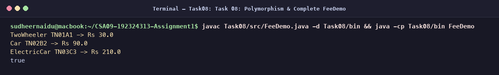

# Task 08: Apply Polymorphism

**Course Outcome**: CO1 – Java fundamentals and object-oriented programming  
**Bloom’s Level**: K4 – Analyse  
**Student Name**: Korasika Sudheer  
**Register Number**: 192324313  

---

## 1. Compile-Time vs. Runtime Polymorphism

Polymorphism ("many forms") enables a single interface or class hierarchy to express differing behaviors.

### 1.1 Compile-Time Polymorphism (Static Binding / Method Overloading)
Compile-time polymorphism occurs when multiple methods in the same class share an identical name with differing parameter signatures.
- **Overloaded Method Example**:
  ```java
  // Overload 1: Duration in elapsed minutes
  public double calculateFee(int minutes) {
      int hours = (minutes + 59) / 60;
      return hours * ratePerHour();
  }

  // Overload 2: Duration computed from entry and exit LocalTime instances
  public double calculateFee(java.time.LocalTime entryTime, java.time.LocalTime exitTime) {
      long minutes = java.time.Duration.between(entryTime, exitTime).toMinutes();
      return calculateFee((int) minutes);
  }
  ```
- **How Compiler Selects It**: During compilation, javac inspects the static types of the arguments passed at the call site. The compiler binds the call directly to the corresponding bytecode descriptor (e.g., `calculateFee(I)D` vs `calculateFee(Ljava/time/LocalTime;Ljava/time/LocalTime;)D`). Selection occurs entirely at compile-time with zero runtime lookup penalty.

### 1.2 Runtime Polymorphism (Dynamic Binding / Method Overriding)
Runtime polymorphism occurs when a subclass overrides an inherited method, and the specific method implementation to execute is resolved dynamically by the JVM at runtime based on the actual object instantiated on the heap.

#### Upcasting in Heterogeneous Collections:
A single uniform array `Vehicle[] parked` holds instances of `TwoWheeler`, `Car`, and `ElectricCar`:
```java
Vehicle[] parked = { new TwoWheeler("TN01A1"), new Car("TN02B2"), new ElectricCar("TN03C3") };
```
Every subclass is safely upcast to its supertype reference `Vehicle`.

#### Eliminating Fragile `if-else` Cascades:
Without polymorphism, the billing loop requires brittle type interrogations:
```java
// PROCEDURAL ANTI-PATTERN (Violates OCP)
for (Vehicle v : parked) {
    double fee;
    if (v instanceof TwoWheeler) {
        fee = ((TwoWheeler) v).calculateBikeFee(130);
    } else if (v instanceof ElectricCar) {
        fee = ((ElectricCar) v).calculateEVFee(130);
    } else if (v instanceof Car) {
        fee = ((Car) v).calculateCarFee(130);
    }
}
```
With polymorphism, the entire cascade collapses into a single expressive statement:
```java
double fee = v.calculateFee(130); // Dynamic method dispatch!
```

---

## 2. Dynamic Method Dispatch Trace

Consider the loop execution:
```java
Vehicle v = parked[2]; // Points to ElectricCar("TN03C3") on the Heap
double fee = v.calculateFee(130);
```

### Trace:
1. **Declared / Static Type**: `Vehicle`.
2. **Actual / Dynamic Object Type**: `ElectricCar`.
3. **Bytecode Invocation**: The compiler emits `invokevirtual #Vehicle.calculateFee(I)D`.
4. **JVM Virtual Table (vtable) Resolution**:
   - The JVM inspects the object header of instance `0x...` on the heap and finds its `klass` pointer pointing to `ElectricCar.class`.
   - The JVM executes `Vehicle.calculateFee(int minutes)` (the inherited template method).
   - Inside `calculateFee`, the call `ratePerHour()` is evaluated via `invokevirtual`.
   - The JVM resolves `ratePerHour()` dynamically in `ElectricCar`'s vtable, traversing up to `Car.ratePerHour()`, returning `30.0`.
   - Billable hours: $(130 + 59) / 60 = 3$. Base fee $= 3 \times 30.0 = 90.0$.
5. **Interface Capability Check**:
   - `if (v instanceof Chargeable c)` evaluates to `true`.
   - `c.chargingFee(10)` invokes `ElectricCar.chargingFee(10)`, returning $10 \times 12.0 = 120.0$.
   - Total fee $= 90.0 + 120.0 = \text{Rs. } 210.0$.

---

## 3. Analysis: Why `new Car("TN02B2").equals(new ElectricCar("TN02B2"))` Prints `true`

### 3.1 Technical Explanation
In `Vehicle`:
```java
@Override
public boolean equals(Object o) {
    return o instanceof Vehicle && regNo.equals(((Vehicle) o).regNo);
}
```
1. `new ElectricCar("TN02B2")` is passed into `Car.equals(Object o)`.
2. The `instanceof Vehicle` evaluates whether the right-hand object inherits from `Vehicle`. Because `ElectricCar extends Car` and `Car extends Vehicle`, `ElectricCar` is indeed an `instanceof Vehicle`.
3. The license plate `regNo` of both objects is identical: `"TN02B2"`.
4. Hence, `.equals()` evaluates to **`true`**.

### 3.2 Is This the Correct Behavior for the Smart-Parking System?
**Yes, this is strictly correct domain behavior.**
- In automotive transportation and parking enforcement, a vehicle's legal and physical identity is determined uniquely by its state-issued registration number (License Plate).
- A motor vehicle cannot be physically cloned; two entries presenting the identical registration plate `"TN02B2"` represent the same physical motor vehicle attempting to enter or exit.
- Treating them as equal prevents fraudulent double-entry, detects ticket misuse, and ensures unified parking accounting.

---

## 4. Alternative Concept & Complexity Analysis

### Comparison: Dynamic Method Dispatch ($O(1)$) vs. Procedural `instanceof` Cascades ($O(k)$)

#### Quantitative Analysis for $k$ Vehicle Subclasses

| Dimension | Dynamic Method Dispatch (vtable) | Procedural `instanceof` Cascade |
| :--- | :--- | :--- |
| **Execution Time Complexity** | **Strictly $O(1)$** | **$O(k)$** worst-case linear branch checks |
| **Branch Predictor Pressure** | Low (Single indirect jump target cached by CPU BTB) | High (Multiple conditional branch predictions subject to pipeline stalls) |
| **Impact of Adding $k+1$-th Type**| Zero changes to caller loop | Must add another `else if (v instanceof TypeK)` check |
| **Bytecode Size** | Minimal (1 single `invokevirtual` instruction) | Bloated ($k$ type comparisons, typecasts, and jumps) |
| **Maintenance Burden** | Zero maintenance on consumer services | Error-prone; missing one branch drops fee computation silently |

**Conclusion**: Runtime dynamic method dispatch is asymptotically faster ($O(1)$ vs $O(k)$), optimizes modern superscalar CPU execution, and fulfills the Open-Closed Principle.

---

## Execution Output & Verification Evidence

### Compilation & Execution Commands
```bash
javac Task08/src/FeeDemo.java -d Task08/bin && java -cp Task08/bin FeeDemo
```

### Verified Terminal Output
```text
TwoWheeler TN01A1 -> Rs 30.0
Car TN02B2 -> Rs 90.0
ElectricCar TN03C3 -> Rs 210.0
true
```

### Execution Output Screenshot

