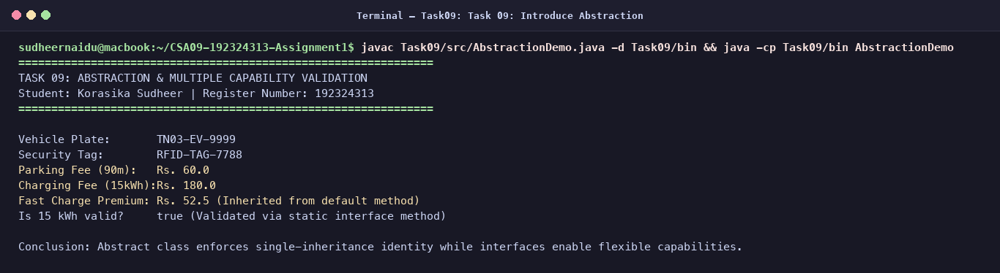

# Task 09: Introduce Abstraction

**Course Outcome**: CO1 – Java fundamentals and object-oriented programming  
**Bloom’s Level**: K4 – Analyse  
**Student Name**: Korasika Sudheer  
**Register Number**: 192324313  

---

## 1. Architectural Role of Abstraction: Abstract Classes vs. Interfaces

Abstraction decouples the high-level operational contract ("what the system does") from low-level execution mechanisms ("how it is done").

### 1.1 Structural Comparison in the Smart-Parking System

| Abstraction Form | Entity Name | Declared Members | Why This Mechanism Was Chosen |
| :--- | :--- | :--- | :--- |
| **Abstract Class** | `abstract class Vehicle` | - Private state `regNo`<br>- Constructor `protected Vehicle(String regNo)`<br>- Abstract method `#ratePerHour()`<br>- Concrete template method `+calculateFee(min)` | Represents fundamental **core identity and shared state** (`is-a` relationship). All motorized vehicles require an immutable registration plate and share identical ceiling calculation mechanics. |
| **Interface** | `interface Chargeable` | `double chargingFee(int kWh)` | Represents an **orthogonal capability** (`can-do` contract). Only certain vehicles (e.g., `ElectricCar`, and later `EBike`) possess charging capabilities. Regular ICE cars and two-wheelers do not. |
| **Interface** | `interface Payable` | `double processPayment(double amount)` | Represents financial transaction capabilities across different payment gateways (UPI, Cash, Fastag). |

---

## 2. Why Abstract Class for `Vehicle` and Interface for `Chargeable`

### 2.1 Why `Vehicle` Must Be an Abstract Class
1. **Shared Invariant State**: Every vehicle inherently possesses a registration number (`regNo`). Interfaces cannot hold instance state (only `public static final` constants). If `Vehicle` were an interface, every subclass (`Car`, `TwoWheeler`, `DeliveryVan`) would be forced to duplicate `private String regNo;` and its constructor validation logic, violating the DRY (Don't Repeat Yourself) principle.
2. **Constructor Enforcement**: An abstract class can declare a protected constructor `protected Vehicle(String regNo)`. This forces every subclass to supply and validate a registration plate at creation time.
3. **Template Method Pattern**: The universal ceiling billing formula `(minutes + 59) / 60 * ratePerHour()` is implemented once in `Vehicle`.

### 2.2 Why `Chargeable` Must Be an Interface
1. **Multiple Inheritance of Type**: Java prohibits multiple class inheritance (`class ElectricCar extends Car, ElectricDevice` is illegal). Interfaces permit a class to implement multiple behavioral contracts:
   ```java
   public class ElectricCar extends Car implements Chargeable, Monitored, Serializable
   ```
2. **Cross-Hierarchy Capability**: `Chargeable` can be implemented by entirely unrelated class hierarchies (e.g., `ElectricCar` in the vehicle hierarchy, and an `ElectricLawnmower` or portable `PowerBank` in an equipment hierarchy).

---

## 3. Advanced Interface Capabilities: `default` and `static` Methods

Introduced in Java 8, `default` and `static` methods expand interface utility without breaking backward compatibility:

### 3.1 `default` Methods in Interfaces
Provides an optional fallback implementation that implementing classes may inherit or override:
```java
public interface Chargeable {
    double chargingFee(int kWh);

    // Default method providing fast-charging estimation
    default double fastChargingSurcharge(int kWh) {
        return kWh * 2.50; // Standard 2.50/kWh peak thermal surcharge
    }
}
```

### 3.2 `static` Utility Methods in Interfaces
Encapsulates factory or validation utilities directly inside the interface namespace:
```java
public interface Chargeable {
    double chargingFee(int kWh);

    static boolean isValidKWh(int kWh) {
        return kWh > 0 && kWh <= 150; // Validates EV battery charging range
    }
}
```

---

## 4. Alternative Concept & Complexity Analysis

### Inverting Abstraction: What If `Vehicle` Were an Interface and `Chargeable` Were an Abstract Class?

#### Concept Inversion
Suppose an architect proposed:
1. `interface Vehicle` with default methods.
2. `abstract class ChargeableDevice` extended by electric vehicles.

#### Architectural Breakdown & What Can No Longer Be Expressed
1. **Loss of Encapsulated State**:
   - Because interfaces cannot declare instance variables, `interface Vehicle` cannot declare `private final String regNo`.
   - Every implementing class (`Car`, `TwoWheeler`, `Bus`) must now independently declare `private final String regNo`, write its own getter, and duplicate validation.
2. **Loss of Enforced Constructors**:
   - Interfaces cannot define constructors. It is impossible to force implementers to initialize `regNo` uniformly.
3. **Fatal Multiple Inheritance Collision**:
   - If `Chargeable` is an abstract class, then `ElectricCar` cannot inherit both from `Car` and `Chargeable`:
     ```java
     // COMPILATION ERROR: Multiple class inheritance is illegal in Java!
     public class ElectricCar extends Car, Chargeable { ... }
     ```
   - The developer would be forced to break the `Car` inheritance chain, creating severe code duplication.

#### Complexity & Runtime Performance Comparison

| Evaluation Metric | Current Design (`Vehicle` Abstract Class, `Chargeable` Interface) | Inverted Design (`Vehicle` Interface, `Chargeable` Abstract Class) |
| :--- | :--- | :--- |
| **Object Memory Footprint** | **Minimal**: Single object header + `regNo` reference | Bloated due to duplicated fields across separate branches |
| **Method Call Dispatch Time** | **$O(1)$ `invokevirtual`** (vtable offset direct jump) | **$O(1)$ `invokeinterface`** (itable lookup, slightly higher constant overhead in older JVMs) |
| **DRY Compliance** | **100%**: `regNo` and ceiling formula defined once | **0%**: Duplicated across all implementing classes |
| **Multiple Capabilities** | Seamless via multiple interface implementation | **Blocked** by Java's single class inheritance constraint |

**Conclusion**: The chosen architecture (`Vehicle` as an abstract class encapsulating identity and template algorithms, combined with `Chargeable` as a flexible interface contract) is the only sound design under Java's language specifications.

---

## Execution Output & Verification Evidence

### Compilation & Execution Commands
```bash
javac Task09/src/AbstractionDemo.java -d Task09/bin && java -cp Task09/bin AbstractionDemo
```

### Verified Terminal Output
```text
===============================================================
TASK 09: ABSTRACTION & MULTIPLE CAPABILITY VALIDATION
Student: Korasika Sudheer | Register Number: 192324313
===============================================================

Vehicle Plate:       TN03-EV-9999
Security Tag:        RFID-TAG-7788
Parking Fee (90m):   Rs. 60.0
Charging Fee (15kWh):Rs. 180.0
Fast Charge Premium: Rs. 52.5 (Inherited from default method)
Is 15 kWh valid?     true (Validated via static interface method)

Conclusion: Abstract class enforces single-inheritance identity while interfaces enable flexible capabilities.
```

### Execution Output Screenshot

