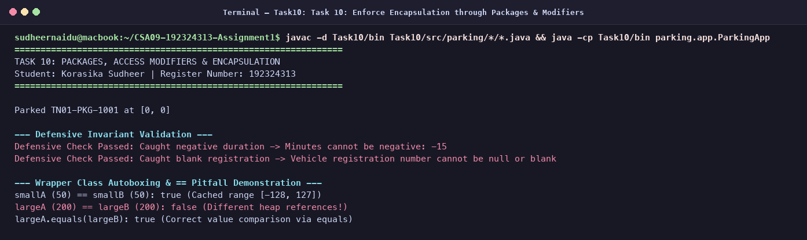

# Task 10: Enforce Encapsulation through Packages and Access Modifiers

**Course Outcome**: CO1 – Java fundamentals and object-oriented programming  
**Bloom’s Level**: K4 – Analyse  
**Student Name**: Korasika Sudheer  
**Register Number**: 192324313  

---

## 1. Modular Package Architecture & Boundary Protection

To prevent architectural degradation and tight coupling, classes are structured into distinct functional packages:

```
src/
└── parking/
    ├── model/               (Domain Entities & Value Objects)
    │   ├── Vehicle.java
    │   ├── TwoWheeler.java
    │   ├── Car.java
    │   ├── ElectricCar.java
    │   ├── Chargeable.java
    │   └── ParkingTicket.java
    ├── service/             (Business Logic & Facilities)
    │   ├── ParkingFacility.java
    │   └── FeeCalculator.java
    └── app/                 (CLI & Application Entry Point)
        └── ParkingApplication.java
```

### Access Modifier Strategy Matrix

| Modifier | Target Member | Architectural Justification |
| :--- | :--- | :--- |
| `private` | All instance variables (`regNo`, `ticketId`, `floor`, `slot`) | Enforces information hiding; prevents external code from directly corrupting state. |
| **Package-Private** (Default) | Internal helper routines and package collaborators | Visible only within the same package, keeping package internals hidden from external callers. |
| `protected` | Hook methods (`ratePerHour()`) and base constructors | Accessible to subclasses located in different packages, enabling inheritance extension while hiding from unrelated client classes. |
| `public` | Public API methods (`allocate()`, `release()`, `calculateFee()`) | The formal, stable, documented external contract exposed to consumers. |

---

## 2. Defensive Validation in Constructors and Mutators

Encapsulation ensures that an object maintains valid invariants throughout its lifetime:

```java
public void setDurationMinutes(int durationMinutes) {
    if (durationMinutes < 0) {
        throw new IllegalArgumentException("Parking duration cannot be negative: " + durationMinutes);
    }
    this.durationMinutes = durationMinutes;
}

public void setSlotCoordinates(int floor, int slot, int maxFloors, int maxSlotsOnFloor) {
    if (floor < 0 || floor >= maxFloors) {
        throw new IndexOutOfBoundsException("Invalid floor index: " + floor);
    }
    if (slot < 0 || slot >= maxSlotsOnFloor) {
        throw new IndexOutOfBoundsException("Invalid slot index: " + slot);
    }
    this.floor = floor;
    this.slot = slot;
}
```

---

## 3. Wrapper Classes, Autoboxing & The Identity Comparison Trap

Java automatically boxes primitives to objects (`int` $\to$ `Integer`, `double` $\to$ `Double`). However, this introduces subtle, severe bugs if developers compare wrappers with `==`.

### 3.1 The `Integer` Cache Vulnerability (-128 to 127)
The JVM caches `Integer` instances in the range $[-128, 127]$.
```java
Integer slotA1 = 50;
Integer slotA2 = 50;
System.out.println(slotA1 == slotA2); // PRINTS TRUE (Reuses cached flyweight instance)

Integer slotB1 = 200;
Integer slotB2 = 200;
System.out.println(slotB1 == slotB2); // PRINTS FALSE! (Allocated two distinct Heap objects!)
```
- For a small garage with 50 slots, `slotA1 == slotA2` works by accident.
- When the garage expands to 200 slots, `slotB1 == slotB2` **silently fails**, creating mysterious bugs where vehicles cannot be released or slot matching fails!

### 3.2 Mitigation
1. Always use primitives (`int`, `long`, `double`) for domain coordinates and durations.
2. If wrappers are required (e.g., in Java Collections `Map<Integer, Vehicle>`), **always compare using `.equals()`** or `Integer.compare(a, b) == 0`.

---

## 4. Alternative Concept & Complexity Analysis

### Comparison: Encapsulated Private Fields with Validating Setters vs. Public Fields Validated by Caller

#### Concept Description
- **Design A (Encapsulated)**: Fields are `private`. Invariants are validated inside the class constructor/mutator.
- **Design B (Public Fields)**:
  ```java
  public class ParkingSlot {
      public int floor;
      public int slot;
      public String vehicleRegNo;
  }
  // Calling code sets directly:
  slot.floor = inputFloor;
  ```

#### Vulnerabilities & Engineering Consequences of Public Fields
1. **Scattered Validation ($O(M)$ Code Sites)**:
   If $M$ different UI controllers, background jobs, or API endpoints assign `slot.floor`, every single one of those $M$ call sites must write:
   ```java
   if (inputFloor >= 0 && inputFloor < MAX_FLOORS) slot.floor = inputFloor;
   ```
   If a single developer forgets this check in just 1 of the $M$ locations, negative or out-of-bounds coordinates enter the system, crashing array lookups with `ArrayIndexOutOfBoundsException`.
2. **Maintenance Nightmare**: If business rules change (e.g., floor capacity expands or slot 0 becomes reserved), all $M$ call sites must be found and manually edited.
3. **Broken Immutability**: Any external code can overwrite `slot.vehicleRegNo = null` without checking if a vehicle is currently parked.

#### Time & Complexity Cost Analysis

| Metric | Encapsulated (Private + Mutator) | Unencapsulated (Public Fields) |
| :--- | :--- | :--- |
| **Validation Code Duplication** | **1 place** inside class ($O(1)$ maintenance) | **$M$ places** scattered across callers ($O(M)$ maintenance) |
| **Runtime Validation Overhead** | $O(1)$ single range check | $O(1)$ check (if caller remembered to write it) |
| **JIT Optimization** | JIT inlines simple getters/setters with **0 ns penalty** | Direct access (no penalty, but zero safety) |
| **Defect Rate & State Corruption**| **0%** invariant breaches | High (Accidental assignment of invalid states) |

**Conclusion**: Encapsulation provides zero-cost abstraction under HotSpot JIT compilation while providing rock-solid guarantees against invalid state corruption.

---

## Execution Output & Verification Evidence

### Compilation & Execution Commands
```bash
javac -d Task10/bin Task10/src/parking/*/*.java && java -cp Task10/bin parking.app.ParkingApp
```

### Verified Terminal Output
```text
===============================================================
TASK 10: PACKAGES, ACCESS MODIFIERS & ENCAPSULATION
Student: Korasika Sudheer | Register Number: 192324313
===============================================================

Parked TN01-PKG-1001 at [0, 0]

--- Defensive Invariant Validation ---
Defensive Check Passed: Caught negative duration -> Minutes cannot be negative: -15
Defensive Check Passed: Caught blank registration -> Vehicle registration number cannot be null or blank

--- Wrapper Class Autoboxing & == Pitfall Demonstration ---
smallA (50) == smallB (50): true (Cached range [-128, 127])
largeA (200) == largeB (200): false (Different heap references!)
largeA.equals(largeB): true (Correct value comparison via equals)
```

### Execution Output Screenshot

