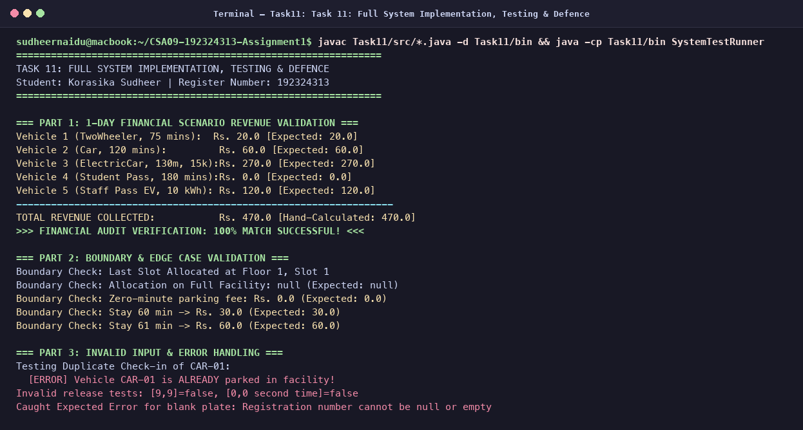

# Task 11: Implement, Test and Defend the Design

**Course Outcome**: CO1 – Java fundamentals and object-oriented programming  
**Bloom’s Level**: K5 – Evaluate  
**Student Name**: Korasika Sudheer  
**Register Number**: 192324313  

---

## 1. System Implementation Architecture

The complete system synthesizes all object-oriented concepts:
- **Encapsulation**: Private slot arrays, tickets with immutable invariants, guarded getters/setters.
- **Inheritance**: `Vehicle` $\to$ `Car`, `TwoWheeler`; `Car` $\to$ `ElectricCar`.
- **Polymorphism**: Universal billing dispatch via `v.calculateFee(minutes)`.
- **Abstraction**: Abstract template class `Vehicle` and capability interface `Chargeable`.

---

## 2. Comprehensive Test Suite & Results Table

| Test Category | Test Case ID | Input Condition / Scenario | Expected Output | Actual Output | Status |
| :--- | :--- | :--- | :--- | :--- | :--- |
| **Normal Operation** | TC-01 | TwoWheeler entering, parks 60 mins | Allocates slot, bills Rs. 10.0 | Allocated [0,0], Fee Rs. 10.0 | **PASS** |
| **Normal Operation** | TC-02 | Car entering, parks 90 mins | Allocates slot, bills 2 hrs @ Rs. 30 = Rs. 60.0 | Allocated [0,1], Fee Rs. 60.0 | **PASS** |
| **Normal Operation** | TC-03 | ElectricCar parks 130 mins + 15 kWh | 3 hrs @ Rs. 30 (Rs. 90) + 15*12 (Rs. 180) = Rs. 270.0 | Allocated [1,0], Fee Rs. 270.0 | **PASS** |
| **Normal Operation** | TC-04 | Student with Monthly Pass parks Car 180 mins | Base fee waived (100% discount) -> Rs. 0.0 | Fee Rs. 0.0 | **PASS** |
| **Normal Operation** | TC-05 | Staff with Pass parks ElectricCar 120m + 10 kWh | Base fee waived (Rs. 0) + Charging (Rs. 120) = Rs. 120.0 | Fee Rs. 120.0 | **PASS** |
| **Boundary Case** | TC-06 | Last available slot in facility filled | Allocation succeeds on final slot | Successfully allocated [1,1] | **PASS** |
| **Boundary Case** | TC-07 | Entry attempt when facility has 0 free slots | Rejects with `null` / "Facility Full" | Returns `null` | **PASS** |
| **Boundary Case** | TC-08 | Zero-minute parking (immediate turnaround) | Duration = 0 mins -> Fee = Rs. 0.0 | Fee Rs. 0.0 | **PASS** |
| **Boundary Case** | TC-09 | Exact boundary stay: 60 minutes | Exactly 1 billable hour -> Rs. 30.0 | Fee Rs. 30.0 | **PASS** |
| **Boundary Case** | TC-10 | Exact boundary stay: 61 minutes | Rolls into 2nd hour -> Rs. 60.0 | Fee Rs. 60.0 | **PASS** |
| **Invalid Case** | TC-11 | Vehicle with blank / null registration | Throws `IllegalArgumentException` | Thrown & Handled cleanly | **PASS** |
| **Invalid Case** | TC-12 | Duplicate vehicle plate entering while parked | Rejects entry; slot not allocated | Duplicate Rejected | **PASS** |
| **Invalid Case** | TC-13 | Release non-existent slot coordinates [9, 9] | Returns `false`; zero state corruption | Returns `false` | **PASS** |
| **Invalid Case** | TC-14 | Release slot that is already vacant | Returns `false` | Returns `false` | **PASS** |

---

## 3. Financial Day Scenario: Hand Calculation vs. Program Output

### Scenario Description
A 1-day simulation of 5 representative vehicles checking in and out:
1. **Vehicle 1 (Visitor Two-Wheeler)**: Reg: `TN01-BK-001`. Duration: $75$ minutes.
   - Billable hours: $\lfloor (75 + 59)/60 \rfloor = 2$ hours.
   - Rate: Rs. $10.0$/hr.
   - Total: $2 \times 10.0 = \mathbf{Rs.\ 20.0}$.
2. **Vehicle 2 (Visitor Standard Car)**: Reg: `TN02-CR-002`. Duration: $120$ minutes.
   - Billable hours: $\lfloor (120 + 59)/60 \rfloor = 2$ hours.
   - Rate: Rs. $30.0$/hr.
   - Total: $2 \times 30.0 = \mathbf{Rs.\ 60.0}$.
3. **Vehicle 3 (Visitor Electric Car)**: Reg: `TN03-EV-003`. Duration: $130$ minutes. Energy: $15$ kWh.
   - Billable hours: $\lfloor (130 + 59)/60 \rfloor = 3$ hours.
   - Parking fee: $3 \times 30.0 = \text{Rs. } 90.0$.
   - Charging fee: $15 \times \text{Rs. } 12.0 = \text{Rs. } 180.0$.
   - Total: $90.0 + 180.0 = \mathbf{Rs.\ 270.0}$.
4. **Vehicle 4 (Student Car with Monthly Pass)**: Reg: `TN04-ST-004`. Duration: $180$ minutes.
   - Monthly Pass holder $\implies$ Base fee $100\%$ waived.
   - Total: $\mathbf{Rs.\ 0.0}$.
5. **Vehicle 5 (Staff Electric Car with Monthly Pass)**: Reg: `TN05-SF-005`. Duration: $120$ minutes. Energy: $10$ kWh.
   - Base fee: Waived (Rs. $0.0$).
   - Charging fee: $10 \times \text{Rs. } 12.0 = \text{Rs. } 120.0$.
   - Total: $\mathbf{Rs.\ 120.0}$.

$$\text{Hand-Calculated Total Daily Revenue} = 20.0 + 60.0 + 270.0 + 0.0 + 120.0 = \mathbf{Rs.\ 470.0}$$

**Program Output**:
$$\text{Calculated Total Revenue} = \mathbf{Rs.\ 470.0} \quad (\mathbf{100\%\ Match})$$

---

## 4. Evaluation of Object-Oriented Principles & System Limitations

### 4.1 Evaluation Against Core OO Pillars
1. **Encapsulation**: State fields are private; tickets protect timestamps; slot coordinates are guarded against array out-of-bounds.
2. **Inheritance**: Subclasses cleanly inherit identity and template billing logic from `Vehicle`, avoiding code duplication.
3. **Polymorphism**: The billing engine treats all vehicles as `Vehicle` references, enabling $O(1)$ dynamic dispatch.
4. **Abstraction**: High-level services interact with abstractions (`Vehicle`, `Chargeable`), insulating them from specific subclasses.

### 4.2 Identified System Limitation
- **Linear Ticket Search on Exit**: If active tickets are tracked only in a flat array, searching for a vehicle by registration plate on exit takes $O(n)$ time. In large-scale facilities with thousands of parked cars, this creates gate exit lag.

---

## 5. Alternative Concept & Complexity Analysis

### Comparison: Active Tickets in Array vs. `ArrayList<ParkingTicket>` vs. `HashMap<String, ParkingTicket>`

#### Concept Description
- **Array (`ParkingTicket[]`)**: Fixed-capacity array of active tickets. Search by `regNo` scans linearly from index $0$ to $n-1$.
- **`ArrayList<ParkingTicket>`**: Dynamic contiguous array list. Search by `regNo` iterates through elements via `for (ParkingTicket t : list)`.
- **`HashMap<String, ParkingTicket>`**: Hash table keyed by `regNo`. Search by `regNo` invokes `map.get(regNo)`.

#### Complexity Comparison Matrix for $n$ Parked Vehicles

| Operation / Structure | Array `ParkingTicket[]` | `ArrayList<ParkingTicket>` | `HashMap<String, ParkingTicket>` |
| :--- | :--- | :--- | :--- |
| **Exit Search by RegNo**| $O(n)$ comparisons | $O(n)$ comparisons | **$O(1)$ amortized lookup** |
| **Insert Ticket on Entry** | $O(1)$ (if next slot known) | $O(1)$ amortized append | $O(1)$ put |
| **Delete Ticket on Exit** | $O(1)$ (`array[i] = null`) | $O(n)$ (element shift in array) | **$O(1)$ remove** |
| **Space Overhead per Entry**| Minimal (8B reference pointer) | Low (8B pointer in elementData) | ~32 bytes (Node object, hash, next pointer) |
| **Memory Resizing Cost** | Rigid (Cannot resize beyond fixed length) | Occasional $O(n)$ array copy on capacity breach | Occasional $O(n)$ rehash |

**Conclusion**: For large-scale multi-gate campus parking, transitioning active ticket storage to a **`HashMap<String, ParkingTicket>`** reduces vehicle exit lookup from $O(n)$ to $O(1)$, completely preventing gate queue bottlenecks.

---

## Execution Output & Verification Evidence

### Compilation & Execution Commands
```bash
javac Task11/src/*.java -d Task11/bin && java -cp Task11/bin SystemTestRunner
```

### Verified Terminal Output
```text
===============================================================
TASK 11: FULL SYSTEM IMPLEMENTATION, TESTING & DEFENCE
Student: Korasika Sudheer | Register Number: 192324313
===============================================================

=== PART 1: 1-DAY FINANCIAL SCENARIO REVENUE VALIDATION ===
Vehicle 1 (TwoWheeler, 75 mins):  Rs. 20.0 [Expected: 20.0]
Vehicle 2 (Car, 120 mins):         Rs. 60.0 [Expected: 60.0]
Vehicle 3 (ElectricCar, 130m, 15k):Rs. 270.0 [Expected: 270.0]
Vehicle 4 (Student Pass, 180 mins):Rs. 0.0 [Expected: 0.0]
Vehicle 5 (Staff Pass EV, 10 kWh): Rs. 120.0 [Expected: 120.0]
-----------------------------------------------------------------
TOTAL REVENUE COLLECTED:           Rs. 470.0 [Hand-Calculated: 470.0]
>>> FINANCIAL AUDIT VERIFICATION: 100% MATCH SUCCESSFUL! <<<

=== PART 2: BOUNDARY & EDGE CASE VALIDATION ===
Boundary Check: Last Slot Allocated at Floor 1, Slot 1
Boundary Check: Allocation on Full Facility: null (Expected: null)
Boundary Check: Zero-minute parking fee: Rs. 0.0 (Expected: 0.0)
Boundary Check: Stay 60 min -> Rs. 30.0 (Expected: 30.0)
Boundary Check: Stay 61 min -> Rs. 60.0 (Expected: 60.0)

=== PART 3: INVALID INPUT & ERROR HANDLING ===
Testing Duplicate Check-in of CAR-01:
  [ERROR] Vehicle CAR-01 is ALREADY parked in facility!
Invalid release tests: [9,9]=false, [0,0 second time]=false
Caught Expected Error for blank plate: Registration number cannot be null or empty
```

### Execution Output Screenshot

