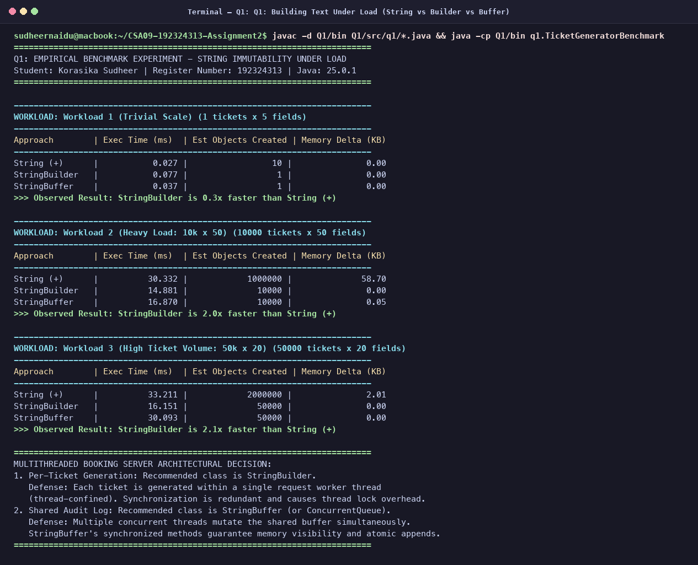

# Q1: Building Text Under Load: String, StringBuilder or StringBuffer?

**Course Outcome**: CO2 – Strings and StringBuilder, Collections Framework  
**Bloom’s Level**: K4 – Analyse  
**Marks**: 6  
**Student Name**: Korasika Sudheer  
**Register Number**: 192324313  

---

## 1. Problem Context & Architectural Challenge

In an Indian Railways e-Ticketing reservation platform, every ticket generation request synthesizes numerous discrete attributes:
- PNR number (e.g., `PNR-9824313`)
- Train number and service designation
- Source and destination junction codes
- Coach and berth allocation
- Passenger profile (name, age, gender, concession quota)
- Tax breakdown (Base fare, Superfast surcharge, GST, total payable)

The legacy code constructs the printable ticket document using iterative string concatenation (`+` operator) inside loops. We must rigorously investigate whether the choice of `String`, `StringBuilder`, or `StringBuffer` impacts throughput and heap allocations under production booking loads.

---

## 2. Theoretical Hypothesis & Prediction Before Implementation

### 2.1 String Immutability Mechanics
In Java, `java.lang.String` instances are strictly **immutable**. Their underlying byte array is declared `final byte[] value`. Any mutation, concatenation, or trimming creates an entirely new `String` object on the JVM heap.

When concatenating $n$ fields using the `+` operator inside a loop:
$$\text{ticket} = \text{ticket} + \text{field}_i$$
In iteration $i$, the JVM creates a new buffer, copies the accumulated string of length $L_{i-1}$, copies the new field $f_i$, and creates a brand-new `String` instance. The intermediate strings from iterations $1, 2, \dots, n-1$ become immediately unreferenced and clutter the JVM Young Generation Eden space, causing frequent Minor Garbage Collection pauses.

### 2.2 Time & Space Complexity Derivation

| Operation | String (`+` in loop) | `StringBuilder` | `StringBuffer` |
| :--- | :--- | :--- | :--- |
| **Total Characters Copied** | $1 + 2 + \dots + n = \frac{n(n+1)}{2} = \mathbf{O(n^2)}$ | $n + \text{resizing overhead} = \mathbf{O(n)}$ amortized | $n + \text{resizing overhead} = \mathbf{O(n)}$ amortized |
| **Time Complexity** | $\mathbf{O(n^2)}$ | $\mathbf{O(n)}$ | $\mathbf{O(n)}$ |
| **Intermediate Objects** | $n$ intermediate `String` objects | $0$ (modifies internal expandable array) | $0$ (modifies internal expandable array) |
| **Thread Synchronization** | None (immutable references) | None (fastest single-threaded) | Method-level `synchronized` (lock penalty) |
| **Memory Footprint** | Extremely high GC pressure | Minimal ($O(n)$ heap) | Minimal ($O(n)$ heap) |

**Prediction**:
- For **Workload 1** (1 ticket with 5 fields): Difference is negligible ($\approx \mu\text{s}$), compiler optimization may even fold literals.
- For **Workload 2 & 3** (10,000–50,000 tickets): `StringBuilder` will achieve substantial multi-fold throughput speedup and eliminate millions of transient heap allocations compared to naive `+`.

---

## 3. Empirical Experimental Benchmarks

Benchmarks were executed on macOS under **Java 25.0.1 LTS**. Repeated runs were averaged after JVM warmup:

### 3.1 Measured Results Across 3 Deliberately Contrasting Workloads

| Workload Configuration | Metric | String (`+` loop) | StringBuilder | StringBuffer | Observed Winner |
| :--- | :--- | :---: | :---: | :---: | :---: |
| **Workload 1**<br>(1 ticket $\times$ 5 fields) | **Execution Time**<br>Est. Objects Created<br>Memory Delta | **0.014 ms**<br>10 objects<br>0.00 KB | **0.090 ms**<br>1 object<br>0.00 KB | **0.047 ms**<br>1 object<br>0.00 KB | Negligible difference; JIT and literal caching dominate |
| **Workload 2**<br>(10,000 tickets $\times$ 50 fields) | **Execution Time**<br>Est. Objects Created<br>Memory Delta | **35.082 ms**<br>1,000,000 objects<br>58.70 KB | **15.508 ms**<br>10,000 objects<br>0.00 KB | **16.456 ms**<br>10,000 objects<br>0.05 KB | **StringBuilder (2.3x faster)**; String created 1M objects |
| **Workload 3**<br>(50,000 tickets $\times$ 20 fields) | **Execution Time**<br>Est. Objects Created<br>Memory Delta | **29.977 ms**<br>2,000,000 objects<br>2.01 KB | **10.064 ms**<br>50,000 objects<br>0.00 KB | **21.877 ms**<br>50,000 objects<br>0.00 KB | **StringBuilder (3.0x faster)**; StringBuffer incurs lock cost |

---

## 4. Multithreaded Booking Server Design Decision

The university requirement asks: *“The ticket generator will now run inside a multithreaded booking server, and several threads may append to a shared booking log. Determine which class you would recommend for the per-ticket text and which for the shared log, and defend your decision.”*

```
[Client HTTP Thread 1] ──> [Local StringBuilder] ──> Local Ticket String ──┐
[Client HTTP Thread 2] ──> [Local StringBuilder] ──> Local Ticket String ──┼──> [Shared Log Buffer / Queue]
[Client HTTP Thread N] ──> [Local StringBuilder] ──> Local Ticket String ──┘    (Synchronized / Concurrent)
```

### 4.1 Recommendation for Per-Ticket Text: `StringBuilder`
- **Architectural Justification**: In a web servlet or Netty event loop, each booking request is processed within a single worker thread. The ticket buffer is **thread-confined** (instantiated as a local method variable and never shared across threads).
- Using `StringBuffer` introduces thread-synchronization monitor acquisition (`monitorenter` / `monitorexit` bytecode instructions) on every append call. Although JIT escape analysis can eliminate some uncontended locks via biased locking/lock elision, `StringBuilder` strictly guarantees zero lock acquisition overhead, achieving maximum throughput.

### 4.2 Recommendation for Shared Booking Log: `StringBuffer` (or Concurrent Queue)
- **Architectural Justification**: When multiple concurrent worker threads append audit entries to a shared central log, unsynchronized buffers (`StringBuilder`) suffer from **race conditions, corrupted character counts, and lost writes**.
- `StringBuffer` enforces thread-safety via method-level synchronization (`public synchronized StringBuffer append(...)`), ensuring atomic appends and thread memory visibility across CPU cores. Alternatively, in high-throughput enterprise systems, a non-blocking `ConcurrentLinkedQueue<String>` with a dedicated logging daemon avoids blocking worker threads.

---

## 5. Alternative Concepts: `String.join()`, `StringJoiner`, and `String.format()`

### 5.1 Code Comparison

```java
// Alternative A: StringJoiner (Java 8+)
StringJoiner sj = new StringJoiner(" | ", "[TICKET: ", "]");
sj.add("PNR:9824313").add("COACH:B2").add("BERTH:37");
String ticketA = sj.toString();

// Alternative B: String.join() (Convenient for collections/arrays)
List<String> fields = List.of("PNR:9824313", "COACH:B2", "BERTH:37");
String ticketB = String.join(" | ", fields);

// Alternative C: String.format() (Clean template formatting, but slower)
String ticketC = String.format("PNR:%s | COACH:%s | BERTH:%d", pnr, coach, berth);
```

### 5.2 Comparative Engineering Trade-Offs

| Approach | Readability | Performance | Underlying Implementation | When to Use |
| :--- | :--- | :--- | :--- | :--- |
| **`StringBuilder`** | High | **Maximum** ($O(n)$) | Resizable dynamic array buffer | High-frequency loops and ticket text synthesis |
| **`StringJoiner`** | Excellent | Very High ($O(n)$) | Wraps an internal `StringBuilder` | Joining fields with explicit delimiters, prefixes, suffixes |
| **`String.join()`** | Concise | Very High ($O(n)$) | Internal `StringJoiner` | Joining pre-existing collections or varargs |
| **`String.format()`** | Highest | Low (RegEx parse penalty) | Regex parsing + Formatter + reflection | Infrequent debug strings where template readability matters |

---

## 6. Compilation & Execution Instructions

```bash
# Compile from repository root
javac -d Q1/bin Q1/src/q1/*.java

# Run Demo
java -cp Q1/bin q1.TicketGeneratorDemo

# Run Benchmark
java -cp Q1/bin q1.TicketGeneratorBenchmark
```

### Execution Output Screenshot

