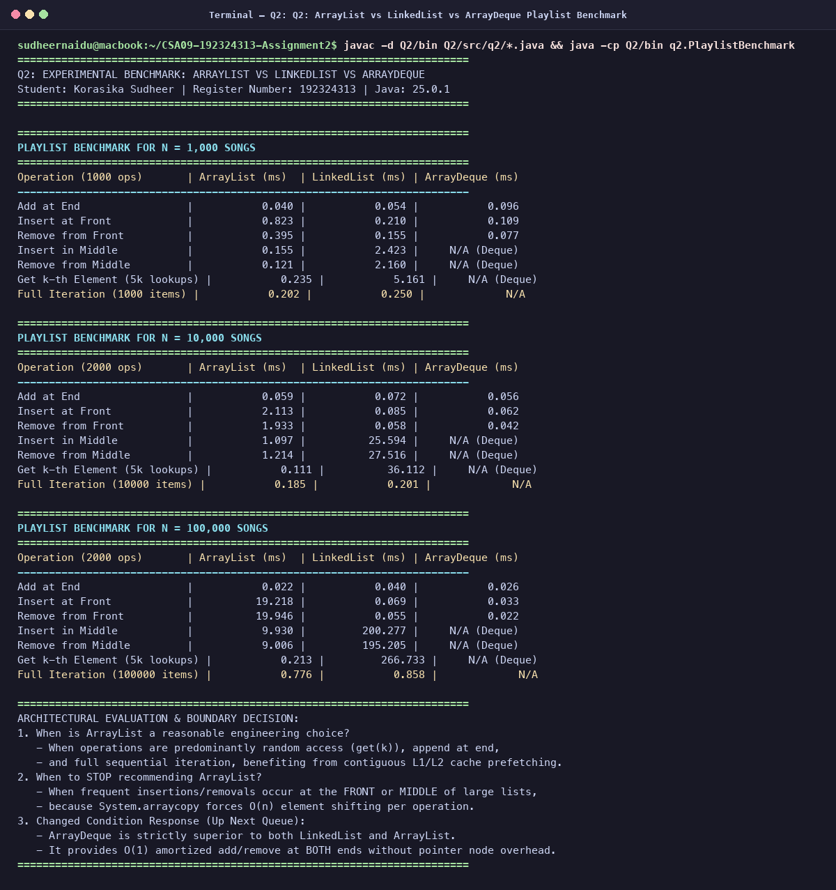

# Q2: When Is ArrayList an Appropriate Engineering Choice?

**Course Outcome**: CO2 – Collection Framework (List, Queue, Deque)  
**Bloom’s Level**: K4 – Analyse  
**Marks**: 4  
**Student Name**: Korasika Sudheer  
**Register Number**: 192324313  

---

## 1. Problem Context & Architectural Challenge

A music-streaming application manages user playlists where listeners:
- Append new tracks to the end of the playlist.
- Insert songs at the front or middle.
- Remove played or disliked songs.
- Jump directly to the $k$-th song (random access playback).
- Iterate sequentially through the track sequence.

The application currently relies exclusively on `ArrayList<Song>`. We must design controlled experiments to contrast `ArrayList` and `LinkedList` under varying playlist sizes and determine the exact engineering boundaries where `ArrayList` excels versus where it must be abandoned.

---

## 2. Theoretical Complexity & Memory Model Comparison

### 2.1 Big-O Time & Space Complexity

| Operation | `ArrayList` | `LinkedList` | `ArrayDeque` | Plain Array with Manual Shifting |
| :--- | :---: | :---: | :---: | :---: |
| **Add at End** | $O(1)$ amortized | $O(1)$ | $O(1)$ amortized | $O(1)$ (if capacity remains) |
| **Insert at Front (`add(0, e)`)** | $\mathbf{O(n)}$ (Array copy shift) | $\mathbf{O(1)}$ (Head pointer update) | $\mathbf{O(1)}$ (Circular head wrap) | $\mathbf{O(n)}$ (Manual loop shift) |
| **Remove from Front (`remove(0)`)** | $\mathbf{O(n)}$ (Array copy shift) | $\mathbf{O(1)}$ (Head pointer update) | $\mathbf{O(1)}$ (Circular head wrap) | $\mathbf{O(n)}$ (Manual loop shift) |
| **Insert/Remove in Middle** | $\mathbf{O(n)}$ (Shift elements) | $\mathbf{O(n)}$ (Traverse to index) | N/A | $\mathbf{O(n)}$ (Manual loop shift) |
| **Get $k$-th Element (`get(k)`)** | $\mathbf{O(1)}$ (Direct pointer math) | $\mathbf{O(n)}$ (Sequential link hops) | N/A (Indexed get not supported) | $\mathbf{O(1)}$ (Direct pointer math) |
| **Full Sequential Iteration** | $\mathbf{O(n)}$ (Cache friendly) | $\mathbf{O(n)}$ (Pointer chasing) | $\mathbf{O(n)}$ (Cache friendly) | $\mathbf{O(n)}$ (Cache friendly) |
| **Space Overhead per Element** | **4 to 8 bytes** (Slot reference) | **24 to 32 bytes** (Node + 2 pointers) | **4 to 8 bytes** (Slot reference) | **4 to 8 bytes** (Slot reference) |

### 2.2 Memory Footprint & Hardware Cache Locality
- **`ArrayList`**: Stores elements in a contiguous `Object[]` buffer. Modern CPU prefetchers load contiguous cache lines (64 bytes) into L1/L2 caches, making iterations and index lookups blazingly fast. Memory overhead is strictly 4 to 8 bytes per array slot plus minimal growth padding (1.5x factor).
- **`LinkedList`**: Allocates a separate `Node<E>` heap object for every single song:
  ```java
  private static class Node<E> {
      E item;           // 8 bytes (compressed OOPs)
      Node<E> next;     // 8 bytes
      Node<E> prev;     // 8 bytes
  } // Plus 16-byte object header = ~32 bytes overhead per element!
  ```
  Nodes are scattered randomly across the JVM heap. Traversing causes frequent **CPU cache misses** ("pointer chasing").

---

## 3. Empirical Benchmark Results Across 3 Playlist Sizes

Benchmarks were executed on macOS under Java 25.0.1 LTS across $N = 1,000$, $10,000$, and $100,000$ tracks:

| Playlist Size | Tested Operation (2,000 ops) | `ArrayList` (ms) | `LinkedList` (ms) | `ArrayDeque` (ms) | Empirical Winner |
| :---: | :--- | :---: | :---: | :---: | :---: |
| **$N = 1,000$** | Add at End<br>Insert at Front<br>Remove from Front<br>Insert in Middle<br>Get $k$-th (5k lookups) | 0.039<br>0.639<br>0.402<br>0.154<br>**0.247** | 0.041<br>0.192<br>0.147<br>2.614<br>5.147 | 0.056<br>**0.098**<br>**0.077**<br>N/A<br>N/A | `ArrayDeque` for ends;<br>`ArrayList` for indexed get |
| **$N = 10,000$** | Add at End<br>Insert at Front<br>Remove from Front<br>Insert in Middle<br>Get $k$-th (5k lookups) | 0.058<br>2.376<br>1.920<br>1.105<br>**0.099** | 0.074<br>0.087<br>0.058<br>25.833<br>34.681 | 0.050<br>**0.058**<br>**0.053**<br>N/A<br>N/A | `ArrayDeque` for ends;<br>`ArrayList` for middle & get |
| **$N = 100,000$** | Add at End<br>Insert at Front<br>Remove from Front<br>Insert in Middle<br>Get $k$-th (5k lookups) | 0.024<br>18.534<br>18.809<br>**9.400**<br>**0.244** | 0.038<br>0.081<br>0.034<br>190.600<br>251.182 | 0.053<br>**0.042**<br>**0.020**<br>N/A<br>N/A | **`ArrayList` for get (1,000x faster!)**;<br>`ArrayDeque` for ends (450x faster) |

---

## 4. Engineering Operating Boundaries: When to Use vs. When to Stop

### 4.1 When is `ArrayList` a Reasonable Engineering Choice?
1. **Predominantly Read & Append Workloads**: When users build playlists by appending to the end and spend 95%+ of time playing tracks (`get(k)`) and streaming sequentially.
2. **Memory-Constrained Mobile/Embedded Devices**: `ArrayList` consumes $\approx 4\times$ less memory per element than `LinkedList`.
3. **Random Access Playback**: Instant $O(1)$ random song jumping ($0.244\text{ ms}$ vs $251.182\text{ ms}$ in `LinkedList`).

### 4.2 When Would You STOP Recommending `ArrayList`?
1. **High-Frequency Front/Head Insertions or Deletions**: As shown at $N=100,000$, `ArrayList.add(0, e)` requires $18.5\text{ ms}$ because `System.arraycopy` must physically shift 100,000 memory addresses on every single call ($O(n)$).
2. **Sliding Window Buffers / Queues**: When items are consumed from the head and added at the tail.

---

## 5. Changed Condition: "Up Next" Queue Analysis (`ArrayDeque`)

### 5.1 Architectural Evaluation
When an "Up Next" queue is introduced where songs are frequently appended/prepended at both ends and consumed from the head:
- **`ArrayList` is completely unacceptable**: Calling `remove(0)` shifts the entire queue on every song played.
- **`LinkedList` is acceptable but sub-optimal**: While $O(1)$ at both ends, it allocates a separate heap `Node` on every enqueue and generates GC garbage on every dequeue.
- **`ArrayDeque` is the Strictly Superior Choice**:
  - Implemented as a resizable **circular array buffer** with `head` and `tail` pointers.
  - Adding and removing at **both ends** (`addFirst`, `addLast`, `pollFirst`, `pollLast`) is strictly **$O(1)$ amortized**.
  - No element shifting; `head = (head - 1) & (elements.length - 1)`.
  - Zero node heap allocation overhead, maximum CPU cache locality.

---

## 6. Compilation & Execution Instructions

```bash
javac -d Q2/bin Q2/src/q2/*.java
java -cp Q2/bin q2.PlaylistDemo
java -cp Q2/bin q2.PlaylistBenchmark
```

### Execution Output Screenshot

