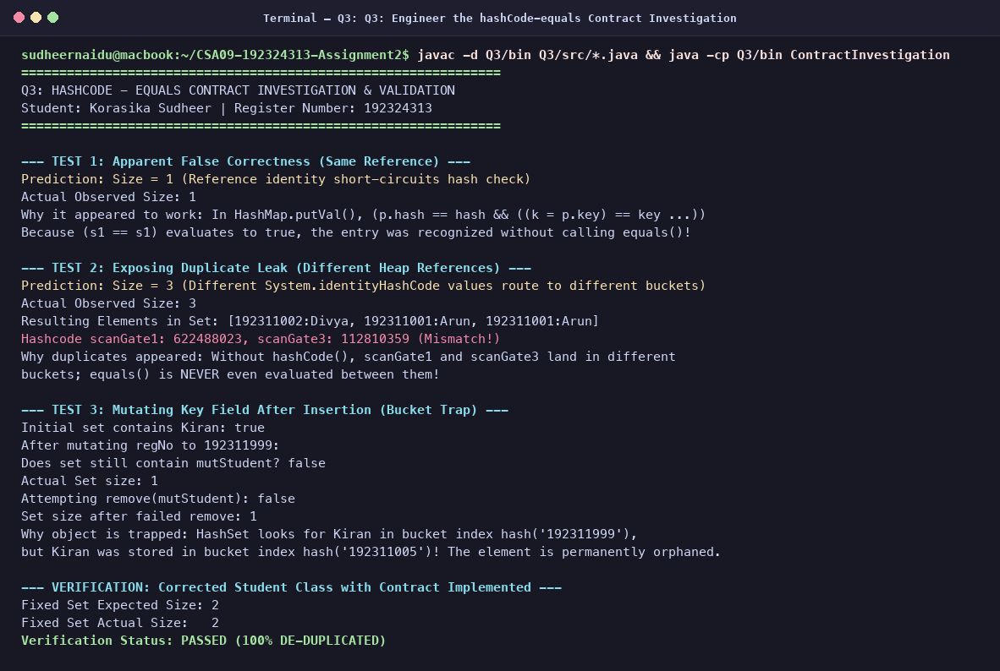

# Q3: Engineer the hashCode–equals Contract

**Course Outcome**: CO2 – Set and Map, the hashCode–equals contract  
**Bloom’s Level**: K4 – Analyse  
**Marks**: 6  
**Student Name**: Korasika Sudheer  
**Register Number**: 192324313  

---

## 1. Problem Context & The Junior Developer's Pitfall

In a university cultural fest, attendance is recorded by scanning student ID cards across multiple entrance gates. To prevent duplicate scans, scans are funneled into a `HashSet<Student>`. A junior developer implemented `Student` with:
```java
public boolean equals(Object o) {
    if (!(o instanceof Student)) return false;
    return regNo.equals(((Student) o).regNo);
}
// hashCode() is NOT overridden!
```

Although the developer assumed overriding `equals()` is sufficient to deduplicate scans, hash-based collections fundamentally depend on the **`hashCode–equals` contract**.

---

## 2. The Java `hashCode()` and `equals()` Contract

The Java SE Language Specification (JLS §3.1) establishes three mandatory rules:
1. **Consistency**: Whenever invoked on the same object more than once during an execution, `hashCode()` must consistently return the same integer, provided no information used in `equals` comparisons is modified.
2. **Equality Implies Equal Hashes**: If two objects are equal according to the `equals(Object)` method, then calling `hashCode()` on each of the two objects **MUST produce the same integer result**:
   $$a.\text{equals}(b) \implies a.\text{hashCode}() == b.\text{hashCode}()$$
3. **Unequal Objects May Share Hashes**: If two objects are unequal according to `equals(Object)`, they are not required to produce distinct integer results (though distinct hashes minimize hash collisions).

---

## 3. Deliberately Designed Experimental Scenarios

### Test 1: Apparent False Correctness (Same Reference Added Twice)
- **Scenario**: Adding the exact same heap reference `s1` twice (`present.add(s1); present.add(s1);`).
- **Predicted Size**: **1**.
- **Actual Size**: **1**.
- **Reasoning**: Inside `HashMap.putVal()`:
  ```java
  if (p.hash == hash && ((k = p.key) == key || (key != null && key.equals(k))))
  ```
  Because `p.key == key` (`s1 == s1`) evaluates to `true` by reference equality, the duplicate is short-circuited and suppressed **without ever needing to invoke `equals()` or compare separate hashcodes**. This creates dangerous false confidence during shallow testing!

### Test 2: Deliberately Exposing Duplicate Leaks (Distinct Objects, Same Data)
- **Scenario**: Adding two distinct heap objects with identical `regNo = "192311001"` scanned at Gate 1 and Gate 3.
- **Predicted Size**: **3** (Duplicates leak into set).
- **Actual Size**: **3** (`[192311002:Divya, 192311001:Arun, 192311001:Arun]`).
- **Reasoning**: Without overriding `hashCode()`, `Student` inherits `Object.hashCode()` which returns `System.identityHashCode()` (derived from the internal memory address). `scanGate1` got hash `622488023` and `scanGate3` got hash `112810359`. They were assigned to completely different hash buckets ($i = (n-1) \& \text{hash}$). `equals()` is **NEVER** called between objects in different buckets!

### Test 3: Mutating `regNo` After Insertion (The Bucket Trap)
- **Scenario**: Inserting `MutableStudent("192311005", "Kiran")`, then mutating `student.regNo = "192311999"`.
- **Predicted Outcome**: Element is permanently trapped; `contains()` returns `false`, `remove()` fails, but `size()` remains 1.
- **Observed Result**:
  - `set.contains(mutStudent)` $\to$ **`false`**.
  - `set.remove(mutStudent)` $\to$ **`false`**.
  - `set.size()` $\to$ **`1`**.
- **Reasoning**: The object was hashed and stored in bucket $B_{\text{old}} = \text{hash}(192311005)$. When searching or removing, `HashSet` computes bucket $B_{\text{new}} = \text{hash}(192311999)$. Bucket $B_{\text{new}}$ is empty! The mutated object is orphaned on the heap, leaking memory. **Lesson: Key fields in hash collections must always be `final` / immutable.**

---

## 4. Complete the Code Verification

### Output Before Completing TODO 1:
```
Unique students: 3
```
*Explanation*: `new Student("192311001", "Arun")` at Gate 1 and Gate 3 had different identity hashes and landed in separate buckets.

### Output After Completing TODO 1:
```java
@Override
public int hashCode() {
    return regNo.hashCode();
}
```
```
Unique students: 2
```
*Verification*: Both Gate 1 and Gate 3 produce the exact same `hashCode = "192311001".hashCode()`. They land in the same hash bucket; `equals()` is evaluated, returns `true`, and the duplicate is successfully rejected.

---

## 5. Alternative Concept & Complexity Analysis

### Comparison: `HashSet<Student>` vs. `TreeSet<Student>` vs. `HashMap<String, Student>`

| Dimension | `HashSet<Student>` | `TreeSet<Student>` (Comparator) | `HashMap<String, Student>` |
| :--- | :--- | :--- | :--- |
| **Time per Scan (Average)** | $\mathbf{O(1)}$ amortized | $\mathbf{O(\log n)}$ (Red-Black tree) | $\mathbf{O(1)}$ amortized |
| **Time per Scan (Worst)** | $O(n)$ (catastrophic collisions) | $O(\log n)$ strictly guaranteed | $O(n)$ |
| **Ordering Property** | Unordered / unpredictable | Strictly sorted by `regNo` | Unordered |
| **Contract Required** | Both `equals()` and `hashCode()` | `Comparator.compare()` or `Comparable` | Key (`String`) already implements contract |
| **Space Complexity** | $O(n)$ (Hash table + entries) | $O(n)$ (Node overhead: left, right, parent, color) | $O(n)$ (Map entries + keys) |
| **Memory per Student** | ~32 bytes overhead | ~48 bytes (Tree node overhead) | ~32 bytes overhead |

**Conclusion**: For large-scale gate scanning ($N > 50,000$), `HashSet<Student>` with immutable `regNo` provides the optimal $O(1)$ constant-time throughput.

---

## 6. Compilation & Execution Instructions

```bash
# Compile
javac -d Q3/bin Q3/src/*.java

# Run Complete the Code Attendance demo
java -cp Q3/bin Attendance

# Run Deep Contract Investigation Suite
java -cp Q3/bin ContractInvestigation
```

### Execution Output Screenshot

