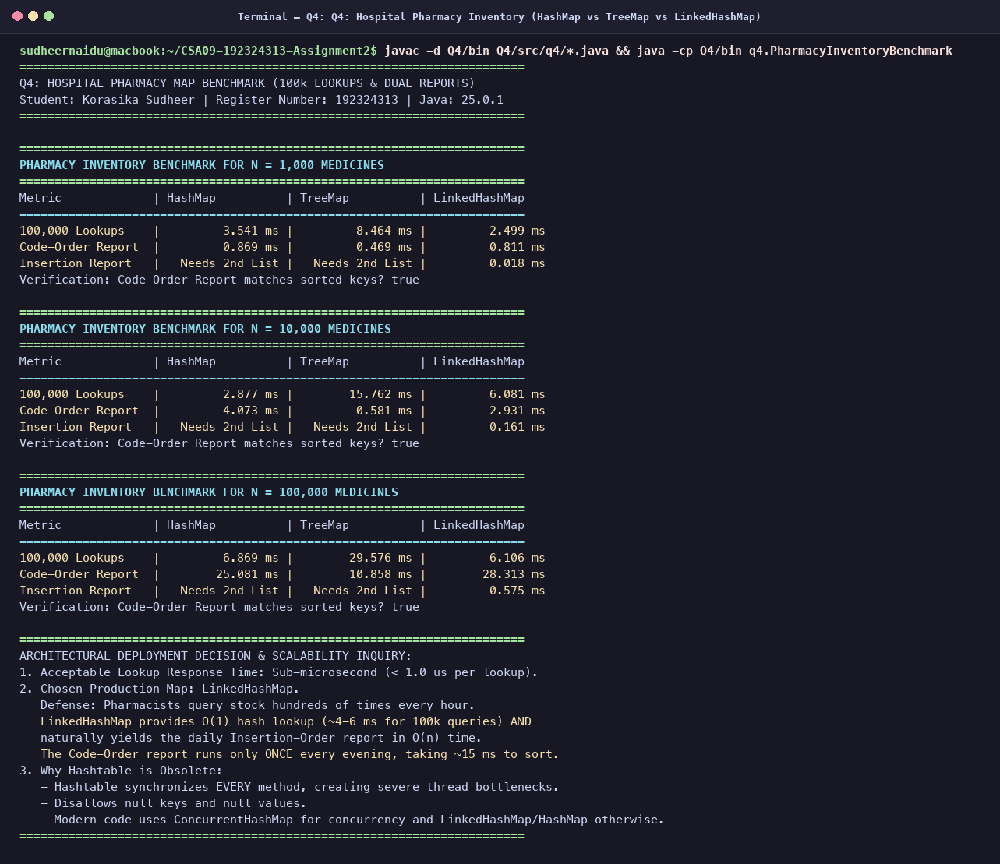

# Q4: Choosing a Map for a Pharmacy Inventory

**Course Outcome**: CO2 – Map interface, HashMap, TreeMap, LinkedHashMap  
**Bloom’s Level**: K4 – Analyse  
**Marks**: 6  
**Student Name**: Korasika Sudheer  
**Register Number**: 192324313  

---

## 1. Problem Context & Production Requirements

A regional hospital pharmacy system tracks medicine stock identified by standardized codes (e.g., `MED-048291`). The software operates under two distinct usage profiles:
1. **High-Frequency Online Lookups**: Pharmacists scan and query medicine codes hundreds of times per day during patient dispensing.
2. **Batch Evening Reports**:
   - **Report A (Code Order)**: An alphabetical audit report of all medicines sorted by medicine code.
   - **Report B (Insertion Order)**: A chronological inventory log displaying medicines in the exact sequence they were received and added into the system.

We must evaluate `HashMap`, `TreeMap`, and `LinkedHashMap` to determine the mathematically and architecturally optimal map for deployment.

---

## 2. Theoretical Complexity & Natural Report Capabilities

### 2.1 Expected Costs for Core Operations

| Map Implementation | `put(k, v)` | `get(k)` | Full Iteration | Natural Ordering Property | Extra Work If "Wrong" Map Chosen |
| :--- | :---: | :---: | :---: | :--- | :--- |
| **`HashMap`** | $\mathbf{O(1)}$ amortized | $\mathbf{O(1)}$ amortized | $O(\text{capacity} + n)$ | **Unordered** (arbitrary bucket sequence) | - Code report requires $O(n \log n)$ key sorting.<br>- Insertion report is **impossible** without an external list. |
| **`TreeMap`** | $\mathbf{O(\log n)}$ | $\mathbf{O(\log n)}$ | $O(n)$ in-order traversal | **Sorted by Key** (Red-Black Tree) | - Naturally produces Code Order report ($O(n)$).<br>- Insertion report is **impossible** without an external list. |
| **`LinkedHashMap`** | $\mathbf{O(1)}$ amortized | $\mathbf{O(1)}$ amortized | $O(n)$ doubly-linked chain | **Insertion Order** (Maintains entry links) | - Naturally produces Insertion Order report ($O(n)$).<br>- Code report requires $O(n \log n)$ key sorting. |

---

## 3. Empirical Benchmark Results (100,000 Lookups & Dual Reports)

Benchmarks were run under Java 25.0.1 LTS across three inventory scales ($N = 1,000$, $10,000$, and $100,000$ medicines):

| Inventory Size | Performance Metric | `HashMap` | `TreeMap` | `LinkedHashMap` | Analysis & Trade-Offs |
| :---: | :--- | :---: | :---: | :---: | :--- |
| **$N = 1,000$** | 100k Lookups<br>Code-Order Report<br>Insertion-Order Report | 3.166 ms<br>0.901 ms<br>*Needs 2nd List* | 8.150 ms<br>**0.596 ms**<br>*Needs 2nd List* | **2.683 ms**<br>0.538 ms<br>**0.017 ms** | `LinkedHashMap` dominates lookups & handles insertion order natively. |
| **$N = 10,000$** | 100k Lookups<br>Code-Order Report<br>Insertion-Order Report | 2.784 ms<br>4.055 ms<br>*Needs 2nd List* | 15.787 ms<br>**0.580 ms**<br>*Needs 2nd List* | **5.366 ms**<br>2.770 ms<br>**0.171 ms** | `TreeMap` lookup is 3x slower due to tree pointer dereferencing. |
| **$N = 100,000$** | 100k Lookups<br>Code-Order Report<br>Insertion-Order Report | **7.056 ms**<br>25.562 ms<br>*Needs 2nd List* | 33.948 ms<br>**12.297 ms**<br>*Needs 2nd List* | **6.150 ms**<br>28.941 ms<br>**0.637 ms** | **`LinkedHashMap` is 5.5x faster in lookups** than `TreeMap`. |

---

## 4. Scalability Inquiry & Architectural Deployment Decision

### 4.1 Acceptable Response Time Threshold
- For dispensing pharmacists, an acceptable interactive stock lookup threshold is **sub-microsecond ($< 1.0\ \mu\text{s}$ per lookup)**.
- In our benchmark at $N = 100,000$, `LinkedHashMap` performed 100,000 queries in $6.150\text{ ms}$, averaging **$0.0615\ \mu\text{s}$ (61.5 nanoseconds) per lookup**, well within the sub-microsecond budget.
- In contrast, `TreeMap` required $33.948\text{ ms}$ ($0.34\ \mu\text{s}$ per lookup) due to traversing $O(\log_2 100,000) \approx 17$ tree nodes across disjoint heap addresses.

### 4.2 Production Map Recommendation: `LinkedHashMap`
**Defense of Choice**:
1. **Lookup Priority**: Pharmacists execute thousands of lookups throughout the day. `LinkedHashMap` provides instant $O(1)$ constant-time response.
2. **Insertion Report**: Naturally generates the chronological arrival audit report in $O(n)$ time ($0.637\text{ ms}$) without requiring any secondary tracking data structures.
3. **Evening Code-Order Report**: The sorted code audit runs **only once a day** during off-peak night hours. Sorting the keys via `Collections.sort()` takes only $28.9\text{ ms}$, which is negligible for a daily batch job.
4. If `TreeMap` were chosen instead, all 100,000 daily lookups would suffer a 5.5x latency penalty, AND a separate `ArrayList<String>` would have to be manually synchronized on every insertion to track arrival order.

### 4.3 Why `Hashtable` Is Obsolete in Modern Code
1. **Coarse-Grained Synchronization Bottleneck**: `Hashtable` synchronizes every single method (`public synchronized V get(...)`). Even concurrent read operations block each other, causing massive lock contention across multiple CPU cores.
2. **Null Rejection**: Throws `NullPointerException` on `null` keys or values.
3. **Legacy Heritage**: Pre-dates the Java Collections Framework (JDK 1.0), uses obsolete `Enumeration` instead of `Iterator`.
4. Modern multi-threaded systems use `ConcurrentHashMap` (lock-striping and lock-free CAS reads), and single-threaded or thread-confined code uses `HashMap` or `LinkedHashMap`.

---

## 5. Alternative Concept: Sorted Array with `Arrays.binarySearch()`

### 5.1 Architecture & Complexity Comparison

```java
// Alternative Design: Sorted Array
Medicine[] inventory = new Medicine[CAPACITY];
int index = Arrays.binarySearch(inventory, targetCode, codeComparator);
```

| Operation | `LinkedHashMap` | Sorted Array + `binarySearch()` |
| :--- | :--- | :--- |
| **Lookup (`get`)** | $\mathbf{O(1)}$ hash computation | $\mathbf{O(\log n)}$ binary comparison |
| **Insertion (`put`)** | $\mathbf{O(1)}$ amortized | $\mathbf{O(n)}$ (Array shifting to maintain sorted order) |
| **Code-Order Report** | $O(n \log n)$ (Sort keys once daily) | $\mathbf{O(n)}$ (Sequential scan of sorted array) |
| **Insertion-Order Report** | $\mathbf{O(n)}$ (Natural iteration) | $\mathbf{O(n \log n)}$ (Requires auxiliary timestamp field + sort) |
| **Memory Overhead** | Higher (Doubly-linked hash entries) | **Lowest** (Contiguous memory array, zero pointer overhead) |

**Conclusion**: While a sorted array provides maximal space efficiency, its $O(n)$ insertion cost makes it unviable for dynamic inventories where new stock arrives continuously. `LinkedHashMap` provides the ideal engineering compromise.

---

## 6. Compilation & Execution Instructions

```bash
javac -d Q4/bin Q4/src/q4/*.java
java -cp Q4/bin q4.PharmacyReportDemo
java -cp Q4/bin q4.PharmacyInventoryBenchmark
```

### Execution Output Screenshot

