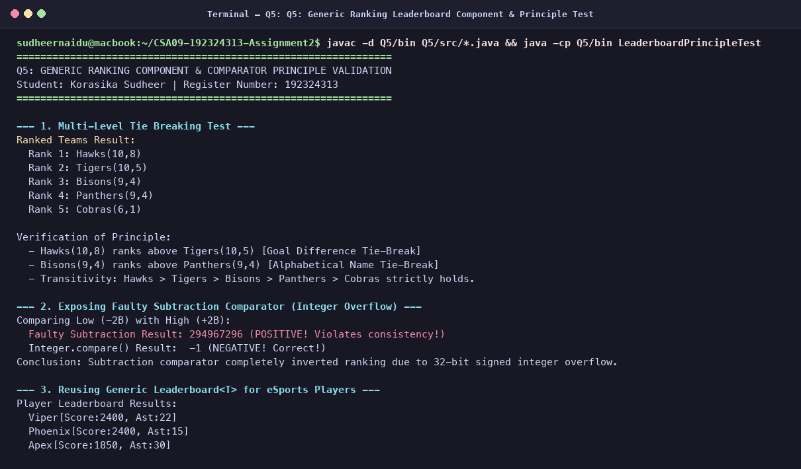

# Q5: Derive a Generic Ranking Component from a Principle

**Course Outcome**: CO2 – Generics, Comparable and Comparator  
**Bloom’s Level**: K4 – Analyse  
**Marks**: 7  
**Student Name**: Korasika Sudheer  
**Register Number**: 192324313  

---

## 1. The Core Ranking Principle

The assignment provides the foundational mathematical specification for relational ranking:
> **“A ranking is correct only if the comparison used is consistent: if A ranks above B and B ranks above C, then A must rank above C, and equal items must compare as equal.”**

This asserts three mandatory axioms of a mathematically sound total preorder / strict weak ordering:
1. **Transitivity of Superiority**: $\text{compare}(A, B) < 0 \land \text{compare}(B, C) < 0 \implies \text{compare}(A, C) < 0$.
2. **Antisymmetry / Inversion**: $\text{sgn}(\text{compare}(A, B)) = -\text{sgn}(\text{compare}(B, A))$.
3. **Transitivity of Equivalence**: $\text{compare}(A, B) == 0 \land \text{compare}(B, C) == 0 \implies \text{compare}(A, C) == 0$.

---

## 2. Architectural Design: `Comparable<Team>` vs. Decoupled `Comparator`

### 2.1 Why Separate `Comparator` Objects are Strictly Superior
- **Multiple Ranking Dimensions**: In inter-collegiate sports, teams may be ranked by:
  - Standard tournament standings (Points $\to$ Goal Difference $\to$ Name).
  - Fair-play discipline standings (Fewest Yellow/Red cards).
  - Head-to-head records or offensive goals scored.
- If `Team` implemented `Comparable<Team>`, it would be locked into a single rigid "natural ordering". Altering the ranking formula would require rewriting and recompiling the entity class, violating the **Open-Closed Principle (OCP)**.
- **Reusability across Heterogeneous Domains**: Decoupling allows our generic `Leaderboard<T>` component to rank `Team`, `Player`, `College`, or `QuizParticipant` simply by supplying an appropriate `Comparator<T>`.

### 2.2 Role of Bounded Wildcards: `Comparator<? super T>`
In `Leaderboard<T>`:
```java
class Leaderboard<T> {
    private final Comparator<? super T> order;
    Leaderboard(Comparator<? super T> order) { this.order = order; }
}
```
Following the **PECS rule** (*Producer Extends, Consumer Super*):
- The `order` comparator **consumes** instances of `T` to compare them.
- Specifying `? super T` ensures that if we have a superclass comparator (e.g., `Comparator<Athlete>` comparing `id`), it can seamlessly rank `Leaderboard<SoccerPlayer>`.

---

## 3. Multi-Field Comparison Expression

Using Java 8+ functional comparator composition:
```java
Comparator<Team> byRank = Comparator
    .comparingInt((Team t) -> t.points).reversed()
    .thenComparing(Comparator.comparingInt((Team t) -> t.goalDiff).reversed())
    .thenComparing((Team t) -> t.name);
```

### 3.1 Explanation: Why Bisons is Ranked Above Panthers
In `LeaderboardDemo`:
- **Panthers**: Points = 9, Goal Difference = 4
- **Bisons**: Points = 9, Goal Difference = 4
1. **Level 1 (Points)**: Both teams have 9 points $\to$ Tie.
2. **Level 2 (Goal Difference)**: Both teams have $+4$ goal difference $\to$ Tie.
3. **Level 3 (Name)**: Evaluates `String.compareTo("Bisons", "Panthers")`. Because `'B'` (ASCII 66) precedes `'P'` (ASCII 80), `"Bisons".compareTo("Panthers") < 0`.
4. Therefore, **`Bisons` strictly ranks above `Panthers`**.

---

## 4. Test Design & Exposing Faulty Comparators

### 4.1 The Integer Subtraction Overflow Pitfall
A common novice error is comparing integer fields via arithmetic subtraction:
```java
// DANGEROUS ANTI-PATTERN:
Comparator<Team> faulty = (t1, t2) -> (t1.points - t2.points);
```
- When comparing `LowValue (-2,000,000,000)` against `HighValue (+2,000,000,000)`:
  $$\text{diff} = (-2 \times 10^9) - (+2 \times 10^9) = -4 \times 10^9$$
- In 32-bit signed two's-complement arithmetic, this underflows and wraps around to **positive `+294,967,296`**!
- The comparator falsely declares that the $-2\text{B}$ team is greater than the $+2\text{B}$ team!
- **Resolution**: Always use `Integer.compare(a, b)` or `Comparator.comparingInt()`.

---

## 5. Alternative Concept: Comparator Chain vs. 3-Pass Stable Sorts

### 5.1 Sorting Three Times with Stable Sort
An alternative approach to achieve multi-criteria ordering is applying three consecutive stable sorts in reverse precedence:
1. Sort 1: By Team Name ($A-Z$).
2. Sort 2: By Goal Difference (descending).
3. Sort 3: By Points (descending).
Because TimSort in Java is **guaranteed stable**, ties from Sort 3 preserve the order established by Sort 2, which preserved Sort 1.

### 5.2 Algorithmic Complexity Comparison

| Dimension | Single Composite Comparator (`byRank`) | Three Consecutive Stable Sorts |
| :--- | :--- | :--- |
| **Passes over Data** | **Single pass** | 3 sequential passes |
| **Time Complexity** | $\mathbf{O(n \log n)}$ | $3 \times O(n \log n) = \mathbf{O(n \log n)}$ (higher constant factor) |
| **Comparisons per Pair** | Short-circuits at first non-zero tie | Evaluates all 3 criteria on entire dataset |
| **Garbage / Allocations** | **Zero** additional array copies | Incurs 3 separate sort invocation overheads |
| **Code Maintainability** | Fluent, declarative, self-documenting | Fragile; reversing execution order breaks correctness |

---

## 6. Compilation & Execution Instructions

```bash
javac -d Q5/bin Q5/src/*.java
java -cp Q5/bin LeaderboardDemo
java -cp Q5/bin LeaderboardPrincipleTest
```

### Execution Output Screenshot

